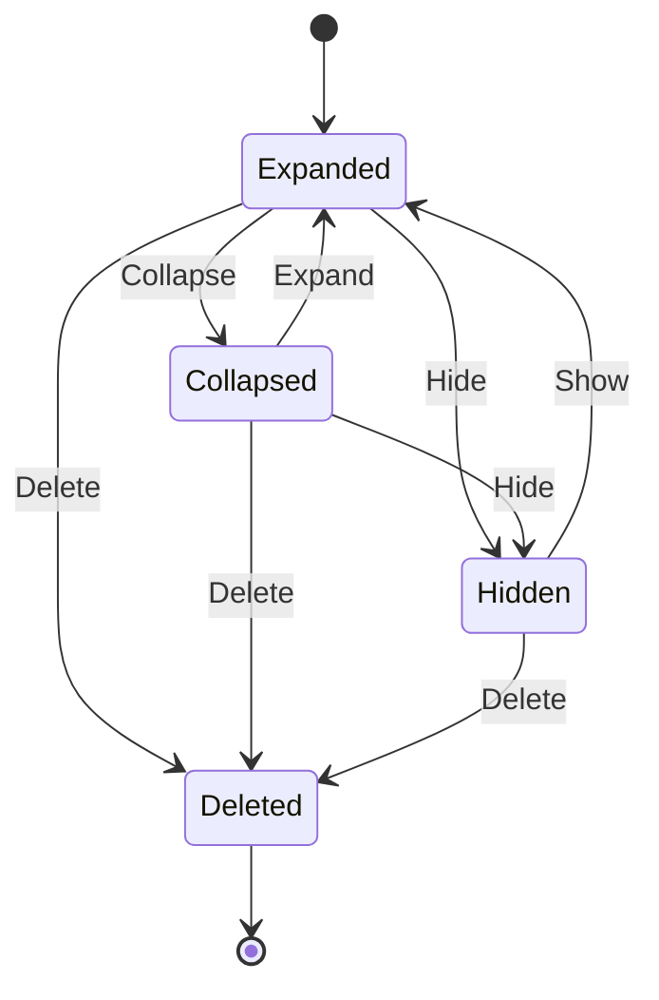
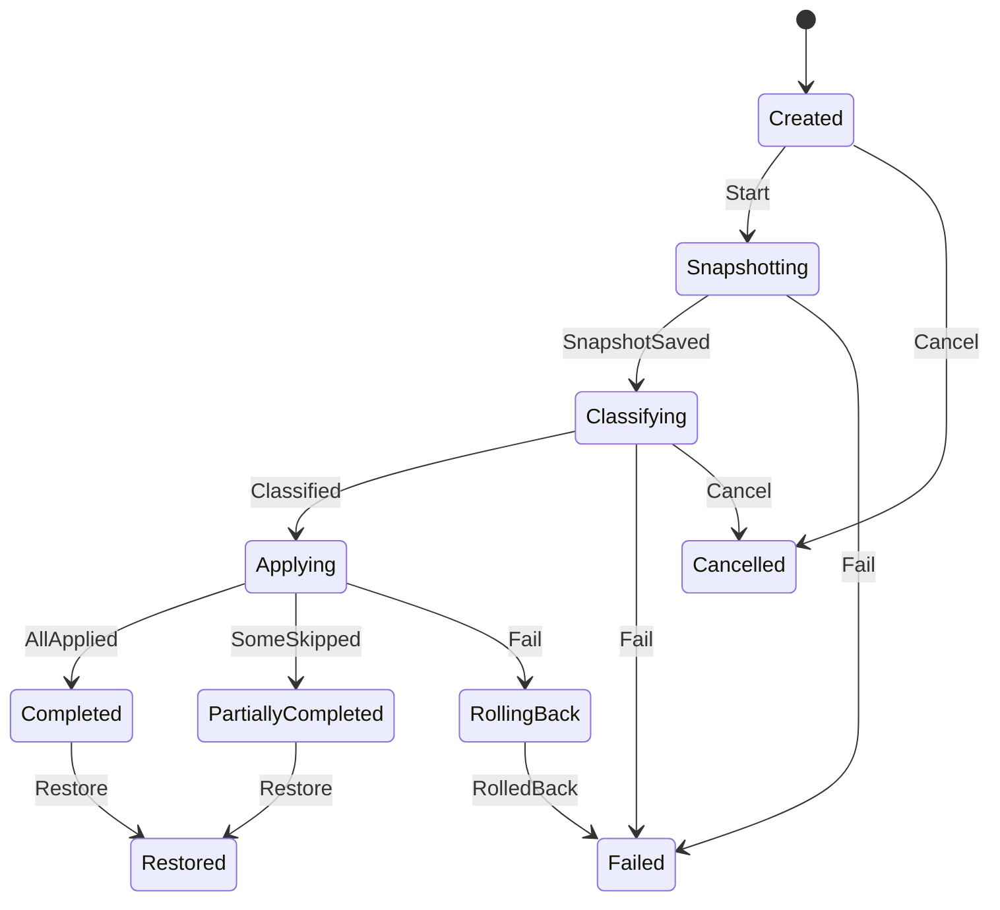

# 《DeskBox 桌面收纳》PRD v1.2.9

> 版本记录：v1.0 初稿 → v1.1 采纳 TDD 三处澄清 + 安全模式/应急开关/首次引导 → v1.2 开源（MIT）、SignPath 签名、winget 分发、隐私措辞修订 → v1.2.1 重名自动改名规则、补回遗漏用户故事、完整非功能需求、补充 Gherkin、整理任务状态机修订 → v1.2.2 跳过原因用户文案、Lost 状态与提示、改名前去除末尾点和空格、恢复连续失败 3 次转 Lost → v1.2.3 新增跳过原因 AlreadyInProgress（同一文件已有进行中的整理） → v1.2.4 方框位置改为相对工作区的 DIP；显示器消失时方框临时挪到主屏、不落库，显示器回来后按原记录恢复；Orphaned 状态已废弃，被临时挪到主屏取代；补充低于 100% 缩放的已知限制；默认收纳库路径定为 `%USERPROFILE%\DeskBox\Vault`，与桌面不同盘时按跨盘跳过、不复制 → v1.2.5 补齐方框 UI 验收：拖放位置/大小、方框间拖文件、右键菜单、第二实例唤醒置前 → v1.2.6 删除方框规则（文件归属转到暂存方框、确认框、空方框直接删、只读拦截、缺暂存方框拒绝）；启动时补建缺失的暂存方框；预览版 zip 的运行与降级提醒 → v1.2.7 桌面嵌入兼容显示（方框必须能看见，嵌不进桌面退回置底窗口）；日志文件路径、滚动与隐私说明 → v1.2.8 启动对账（P0）：启动和 Explorer 重启时把桌面文件对账进暂存方框，清理文件已不存在的归属，扫描不完整时不删任何记录 → v1.2.9 启动对账删行范围收窄到当前用户桌面/公共桌面直属文件；无效 `file_id` 的项跳过并逐条告警；补充桌面搬家后的已知限制与 FWF_NOICONS 前置条件。

## 1. 背景与目标
Windows 用户的桌面常堆满快捷方式、截图和临时文件。DeskBox 要做到：
1. 用**桌面分区方框**就地整理文件（主模式，类似 Fences，文件位置不变）；
2. 按规则**自动归类**；
3. 任何整理操作都能**一键还原**，保证不丢文件。
"移入收纳库"作为可选模式。

**成功指标（MVP）**：一键整理 ≤ 2 秒（500 个文件）；空闲内存 ≤ 80 MB、CPU ≤ 1%；文件丢失 0；还原成功率 100%。

**范围**：Win10 1809+ / Win11，仅 x64；C# / .NET 8 + WPF；免费开源（MIT），仓库公开于 `jiuyang5354/deskbox`；不做云同步；界面先中文、预留英文；对标 Fences / 腾讯桌面整理，MVP 4–6 周。

## 2. 用户故事
| ID | 角色 | 故事 | 价值 |
|---|---|---|---|
| US-1 | 办公用户 | 一键把桌面按类型归入方框 | 快速找到文件 |
| US-2 | 用户 | 整理结果不满意时一键还原 | 无后顾之忧 |
| US-3 | 用户 | 自定义规则（扩展名、关键字/正则、修改时间） | 贴合个人习惯 |
| US-4 | 用户 | 把不常用文件移入收纳库，可随时还原 | 桌面更清爽 |
| US-5 | 多屏用户 | 每个显示器分别记住方框布局，拔插后自动恢复 | 不用反复摆放 |
| US-6 | 用户 | DeskBox 出问题时仍能看到系统桌面图标 | 不会以为文件丢了 |
| US-7（P0） | 用户 | 新建方框、命名、拖动位置、调整大小 | 按自己的方式划分桌面 |
| US-8（P1） | 用户 | 开启"实时收纳"（默认关闭）：新文件落到桌面后等待 3 秒（等写入完成）再自动归类 | 桌面始终整洁 |
| US-9（P1） | 用户 | 托盘图标常驻，并可设置开机自启（首次安装时勾选） | 随用随开 |
| US-10（P2） | 用户 | 折叠方框、调节透明度、双击桌面空白处隐藏/显示全部图标 | 需要时桌面一片干净 |
| US-11（P0） | 用户 | 在方框标题栏或边框拖动位置、拖边调整大小，松手后记住布局 | 布局可持久化 |
| US-12（P0） | 用户 | 把文件在方框之间拖放归属 | 手动微调归类 |
| US-13（P0） | 用户 | 对方框或文件点右键，完成常用操作 | 不依赖设置页也能操作 |
| US-14（P0） | 用户 | 再次启动 DeskBox 时已有实例被带到前台 | 不会开出两个进程 |

## 3. 状态机
### 3.1 方框（Fence）

非法流转一律拒绝（抛 `InvalidTransitionException`）。暂存方框（`is_staging=1`）不可删除。方框所在显示器拔出时**不改变方框状态**：方框整体临时显示在主屏工作区内（不写回数据库），显示器回来后按原记录恢复。原 Orphaned 状态已废弃，被临时挪到主屏取代（v1.2.4）。

### 3.2 一键整理任务（OrganizeJob）

必须先成功写入快照才允许动文件；**只能在 Classifying 阶段取消**（尚未动任何文件）；Applying 阶段不可取消；Applying 中发生致命错误时进入 RollingBack，按 Journal 回滚已移动的文件后进入 Failed。Failed / Cancelled / Restored 为终态。

## 4. 数据字典（要点）
| 实体 | 字段 | 类型 | 规则 |
|---|---|---|---|
| fence | id | GUID | 必填 |
| | title | string | 1–32 字符，去首尾空格 |
| | monitor_id | string | 显示器指纹，必填 |
| | x, y | int | 相对所在显示器**工作区**（不含任务栏）左上角的 **DIP**（与 DPI 无关的逻辑像素，96 DPI 下 1 DIP = 1 物理像素）（v1.2.4） |
| | width, height | int | DIP，≥ 120（v1.2.4） |
| | **dpi** | int | 48–960，只记录上次保存时所在显示器的 DPI，供诊断参考；**不参与位置换算**（v1.2.4） |
| | opacity | int | 20–100 |
| | is_staging | bool | 主屏暂存方框，不可删除 |
| fence_item | file_path | string | **全局唯一**（一个文件只属于一个方框，v1.1） |
| | file_id | string | `卷序列号(8 hex):文件ID(32 hex)` |
| | is_public_desktop | bool | 公共桌面项：可映射、可在方框间拖动，**不可移入收纳库**（v1.1） |
| rule | name / category | string | 1–32 |
| | priority | int | ≥ 0，升序匹配，首条命中 |
| | conditions | — | 扩展名、关键字、正则（100 ms 超时视为不匹配）、修改时间范围 |
| snapshot | trigger | enum | Manual / Auto / BeforeRestore；保留最近 10 份 |
| vault_record | original_path / vault_path / file_id | — | 原路径 ≠ 收纳路径；只能还原一次 |
| journal | status | enum | Pending → Committed / RolledBack / **Lost**（v1.2.2） |
| | actual_target_path | string | Commit 时写入实际落盘路径（自动改名后可能带 " (n)"） |
| | file_id | string | Begin 时记录，恢复时按 file_id 判断回滚 / 补提交 / 在收纳库查找 / 标记 Lost（v1.2.2） |
| | recovery_failures | int | ≥ 0，默认 0；启动恢复该条失败一次 +1。**连续 3 次启动恢复失败 → 转为 Lost 并触发 Lost 提示**；失败计数、提示记录和 MarkLost 在**同一个事务**中提交（v1.2.2） |
| lost_file_notice | entry_id / file_name / acknowledged | — | 按 entry_id 去重；先写提示再 MarkLost，同一事务提交；用户点"知道了"后 acknowledged=1（v1.2.2） |

内置规则：快捷方式（.lnk/.url）、截图（png/jpg 且文件名含 Screenshot/截图/屏幕截图）、图片、文档、压缩包、安装包（exe/msi）、文件夹、其他（未命中）。

日志中文件路径只记哈希 + 文件名。

**跳过原因用户文案（v1.2.2）**：界面只显示下列文案，不显示枚举名；资源键就是 `Strings.resx` 中的枚举名本身（不加前缀），`SkipReasonText` 按 `reason.ToString()` 查找。

| 枚举 | Strings.resx 键 | 用户文案 |
|---|---|---|
| Locked | Locked | 文件正被其他程序使用 |
| CloudOnly | CloudOnly | 这是 OneDrive 云端文件，还没下载到本机 |
| NeedsAdmin | NeedsAdmin | 公共桌面上的文件需要管理员权限 |
| NotFound | NotFound | 文件已被删除或移走 |
| CrossVolume | CrossVolume | 收纳库和桌面不在同一个磁盘上 |
| ReadOnly | ReadOnly | 磁盘处于写保护状态 |
| NameConflict | NameConflict | 同名文件太多，无法自动改名 |
| IoError | IoError | 未知错误，详情见日志 |
| AlreadyInProgress | AlreadyInProgress | 这个文件正在整理中，已跳过 |

**Lost 提示（v1.2.2）**：原文为"有 {count} 个文件在上次整理中断后没能找回：{fileNames}。它可能已被移动或删除，你可以在收纳库和桌面上搜索这个文件名。"（count 与文件名为变量，示例："有 1 个文件在上次整理中断后没能找回：notes.txt。它可能已被移动或删除，你可以在收纳库和桌面上搜索这个文件名。"）。启动时弹窗显示一次；之后常驻在 **设置 > 整理记录**，直到用户点击"知道了"。

## 5. 边界与异常矩阵
| 场景 | 处理 |
|---|---|
| 目标重名 | 绝不覆盖。自动改名为 `name (n).ext`（n 从 2 到 999 依次尝试，不预先检查是否存在，以移动操作本身的"已存在"错误为准，防止竞争）；界面提示"已自动改名"；999 个名字都被占用则跳过（NameConflict）并提示 |
| 文件名末尾带点或空格（如 `report. `） | 生成改名目标时**先去掉名字末尾的点和空格，再拆扩展名**：`report. ` → `report (2)`；访问源文件时仍使用原名（v1.2.2） |
| 还原时原路径已被占用 | 同样自动改名为 `name (n).ext`，提示"已自动改名"，不覆盖新文件 |
| 文件被占用（共享冲突 / 锁冲突） | 跳过（Locked），其余文件继续 |
| 只读介质 / 需管理员 | 跳过（ReadOnly / NeedsAdmin） |
| 其他磁盘错误 | 跳过（IoError） |
| 路径超过 260 字符、文件名含 emoji 等 | 正常处理（长路径支持，Unicode 全支持） |
| 桌面文件超过 2000 个 | 分批处理并显示进度条 |
| 跨磁盘分区 | 跳过（CrossVolume），收纳库不跨分区；默认路径 `%USERPROFILE%\DeskBox\Vault` 若与桌面不同盘，同样跳过、不复制（v1.2.4） |
| OneDrive 仅云端文件 | 跳过（CloudOnly） |
| 文件已被删除 | 跳过（NotFound），并从方框移除 |
| 系统图标（此电脑、回收站） | 不移动，只映射 |
| 整理中途崩溃 | 启动时先按 Journal 恢复 Pending 条目；每条单独处理，一条出错不影响其他条；同一条连续 3 次启动恢复失败 → 转为 Lost 并弹出 Lost 提示（v1.2.2） |
| 恢复时文件按 file_id 找不到 | 标记为 Lost，弹出 Lost 提示（v1.2.2） |
| Explorer 重启 | 自动重新嵌入桌面层 |
| 显示器拔出 | 该显示器上的方框**临时挪到主屏工作区内**完整显示，**不写回数据库**（库里仍是原显示器和原位置）；显示器插回后按原记录恢复位置和大小（v1.2.4） |
| **DeskBox 崩溃导致桌面为空（P0）** | 托盘提供"临时显示系统桌面图标"应急开关；**连续 2 次在启动后 30 秒内崩溃 → 自动进入安全模式**（不接管图标）并提示用户 |
| 首次启用 | 引导说明"图标由 DeskBox 显示，文件位置不会改变"，用户确认后才隐藏系统图标 |
| 卸载 | 恢复系统桌面图标，收纳库文件全部还原 |

## 6. 系统集成
- 开机自启：首次安装时让用户勾选；MSIX 用 `StartupTask`，EXE 安装包用 HKCU Run。
- 多显示器 / DPI：按显示器分别记住布局；位置以工作区相对 DIP 存储，换缩放比例后方框位置和大小保持不变（v1.2.4）。
- 默认收纳库路径：`%USERPROFILE%\DeskBox\Vault`（用户配置目录下）。与桌面不在同一磁盘时，整理按跨盘跳过（CrossVolume），**不复制**文件（v1.2.4）。
- 启动顺序（v1.2.6）：单实例锁 → 迁移 → **暂存方框自检** → 日志恢复 → 枚举桌面 → 嵌入。自检发现暂存方框缺失时补建一个（默认位置），记警告日志；重复启动不会建出第二个；补建失败则进入只读模式。
- 桌面嵌入（v1.2.7）：**硬规则：方框必须能看见，嵌不进桌面也要显示。**
  - 按窗口结构判断桌面层级，不按系统版本号或产品名判断（Win11 24H2/25H2 起 WorkerW 挂在 Progman 下面；部分 25H2 机器注册表产品名仍写 Windows 10）。
  - 嵌入后校验不通过时，撤回嵌入，退回普通置底窗口（**兼容显示**）。托盘图标提示改为「桌面嵌入不可用，已切换为兼容显示」，不弹窗打扰。
  - 兼容显示**不是**只读模式：文件收纳、移动照常可用。
  - 兼容显示下方框始终在最底层，不抢焦点，不能浮到其他窗口上面。
  - 兼容显示下方框任何时候都不能盖住别的窗口，程序主动调用也一样：第二次启动 DeskBox 时不激活、不把方框提到前面，改为托盘弹一次提示「DeskBox 已在运行」；正常嵌入状态下的第二次启动行为不变。
  - Explorer 重启（`TaskbarCreated`）后，重新完整走一遍层级判断 → 嵌入 → 校验，不沿用旧的父窗口；嵌入成功则回到桌面层，托盘提示恢复正常。
- 检查更新：读取 GitHub Release latest 接口，稳定版 / 预览版两个通道，可在设置中关闭。

## 6A. 非功能需求
### 性能
- 启动到方框可见 ≤ 1.5 秒。
- 空闲内存 ≤ 80 MB，空闲 CPU ≤ 1%（空闲时除 Explorer 巡检外不轮询）。
- 一键整理 500 个文件 ≤ 2 秒；超过 2000 个文件分批执行并显示进度条，界面不卡顿。
### 兼容性
- Win10 1809+ / Win11，x64；多显示器、不同 DPI 缩放、显示器拔插。
- 已知限制（v1.2.4）：缩放低于 100% 时，位置换算后再保存可能有 1 像素以内的偏差；当前显示器标识换个登录会话可能变化，拔插或重新登录后方框可能回不到原来那块屏幕，后续改用硬件标识解决。
- 路径超过 260 字符、文件名含 emoji / 生僻字均可处理。
- OneDrive 同步的桌面：仅云端文件不移动。
### 可靠性
- 文件丢失 0，还原成功率 100%；所有移动经 Journal 预写日志，崩溃后启动时先恢复。
- 绝不覆盖任何文件；重名自动改名。
- Explorer 重启后自动重新嵌入；连续 2 次启动 30 秒内崩溃进入安全模式；托盘应急开关可随时显示系统图标；崩溃和卸载后系统桌面图标必须恢复。
### 安全与隐私
- 普通用户权限运行，不请求管理员权限；需要管理员权限的文件直接跳过。
- 只在检查更新时访问 GitHub，不上传任何数据，可在设置中关闭；日志只记路径哈希 + 文件名。
### 交付
- 开源 MIT；GitHub Release 提供 MSIX 与 EXE 安装包，附 SHA256 与 SBOM；winget 上架；正式版经 SignPath 签名。
- 卸载时还原收纳库文件并恢复系统图标。
- 日志文件（v1.2.7）：写在 `%LocalAppData%\DeskBox\logs`，单个文件 5MB，滚动保留 3 份。记录系统 build 号和 DisplayVersion、嵌入走的路径（层级判断、父窗口、校验结果）、扫描桌面找到的文件数和写入数据库的行数。只记文件名和数量，**绝不记文件内容**。
- 日志隐私（v1.2.7）：日志只存在用户自己的电脑上，用户主动发给我们才会离开电脑。用户反馈问题时请附上日志；要贴到公开的 GitHub issue 之前，先提醒用户文件名可能涉及隐私。
- 内测预览版（v1.2.6）：main 每次构建产出 `win-x64` 自包含 zip（文件名带提交号），解压即可运行，无需另装 .NET 8。未签名，首次运行会出现 SmartScreen「已保护你的电脑」，点「更多信息」→「仍要运行」。预览版与正式版共用 LocalAppData 中的数据库/日志和收纳库；迁移只向前，**不支持降级**，不要用旧 zip 打开已被新版本升级过的库。

## 7. 开源、签名与分发（v1.2）
- 协议 MIT，仓库公开；首版附 README、CONTRIBUTING、PRIVACY。
- 代码签名：向 **SignPath Foundation** 申请免费开源签名，待首个内测版公开后申请；内测阶段不签名。
- 分发：GitHub Release + **winget**。
- 隐私说明：**只在检查更新时访问 GitHub，不上传任何数据，并且可以在设置里关掉。**

## 7A. 方框 UI 验收（v1.2.5，任务 5）
本波交付范围：**拖放、右键菜单、第二实例唤醒置前**。隐藏系统桌面图标（`FWF_NOICONS`）不在本波，后续单独设计。

### 拖放
1. **拖动方框**：按住标题栏或边框空白处拖动；松手后位置以工作区相对 DIP 写入数据库；拖动中不落库。
2. **调整大小**：拖四边或四角；最小宽高均为 120 DIP；松手后宽高写入数据库。
3. **方框间拖文件**：从 A 方框拖到 B 方框松手后，该文件只属于 B（`fence_item.file_path` 全局唯一）；桌面上的真实文件路径不变（主模式）；公共桌面项可在方框间拖，不可拖进收纳库入口。
4. **拖到非法目标**：拖到方框外桌面空白、或其他应用窗口时，操作取消，归属不变。
5. **只读模式**：启动恢复失败进入只读后，拖放文件、移入收纳库等写操作全部拒绝并提示；拖动方框位置/大小仍允许（只改布局，不动文件）。

### 右键菜单
**方框空白处 / 标题栏**（至少包含）：
- 重命名
- 折叠 / 展开（按当前状态二选一显示）
- 删除（暂存方框 `is_staging=1` 无此项，或点了提示不可删除；规则见下方「删除方框」）
- 透明度（提供若干档，如 40% / 70% / 100%）

**方框内文件项**（至少包含）：
- 打开
- 打开文件位置
- 移到其他方框…（列出其余方框）
- 移入收纳库（公共桌面项无此项，或点了被拒绝并提示）
- 从方框移除（仅去掉映射，不删除磁盘文件）

菜单项在只读模式下：打开类可用；会移动文件或改归属的项禁用并提示原因。删除方框会改归属，只读时同样拦住；重命名、透明度、折叠/展开只改外观，只读时照常可用（v1.2.6）。

### 删除方框（v1.2.6）
1. **文件归属转到暂存方框**：方框里的文件不丢归属，全部转到暂存方框，排在暂存方框已有项的后面。只改 `fence_item`，在一个事务里完成，磁盘上的文件不动（不调用 `MoveFileExW`）。
2. **确认框**：方框里有文件时弹一次确认框，文案写明「方框里的 N 个文件会移到暂存方框，磁盘上的文件不动」。默认选中「取消」，按回车或 Esc 都不会删。
3. **数量以实际为准**：N 在事务里重新算。弹框期间数量有变化也照常执行，不再弹第二次确认框，结果提示写实际转过去的数量。
4. **空方框**：不弹确认框，直接删除。
5. **只读模式**：拒绝删除并提示原因，什么都不改。
6. **暂存方框缺失**：正常情况下不会出现。若缺失则拒绝删除、什么都不改，记一条 `StagingFenceMissing` 错误日志，界面提示「数据异常，未删除」，不在删除时顺手重建（重建由启动自检负责）。

### 第二实例唤醒置前（仅限正常嵌入桌面时；兼容显示下见 §6 桌面嵌入（v1.2.7））
1. 已有实例在运行时再启动一次：新进程不打开数据库、不碰文件，向已运行实例发激活信号后自行退出。
2. 已运行实例收到信号后：把主界面/方框窗口带到前台（恢复最小化、激活、置前）；若当时在托盘，同样显示方框。
3. 同一时刻系统里只存在一个 DeskBox 进程在写库和整理。

## 7B. 启动对账（v1.2.8，v1.2.9 修订，P0）
> 技术实现见 TDD §4.5.5（v1.0.14），本节为产品规则。

**时机**：启动时在枚举桌面之后、嵌入之前执行一次；Explorer 重启（`TaskbarCreated`）后再执行一次。实时增量监听不在本次范围，后续单独 PR。

**规则**
1. 整次对账在一个事务里完成；全程不调 `MoveFileExW`，不移动任何文件。只读模式下跳过对账、什么都不写，记一条 `DesktopScanSkipped`。
2. 范围是用户桌面 + 公共桌面。去重只针对枚举结果里同一个完整路径出现多次的情况（路径比较不区分大小写），同一路径只收一次。用户桌面和公共桌面上的同名文件完整路径不同，两个都收（两条记录），与资源管理器的显示一致。公共桌面的文件只记归属，**绝不移动**。
3. 隐藏文件和系统文件不收（例如 `desktop.ini`）；快捷方式和文件夹照常收。
4. 已经在某个方框里的文件保持原样；新发现的文件追加到暂存方框末尾，按自然排序、不区分大小写。
5. 文件已不存在的归属行会被清理，每清理一条记一条 `FenceItemPruned`，日志里只记文件名。仅云端的文件（OneDrive 占位文件）视为存在，不清理。**（v1.2.9）只清理父目录正好是本次扫描的用户桌面或公共桌面、且文件已不在磁盘上的行**；其他行（例如父目录是桌面搬家前的旧路径）一律保留，计入跳过数，并记一条 `DesktopScanPruneSkipped`，写明跳过了多少行。
6. **只有扫描完整成功才清理。** 用户桌面和公共桌面都读取成功，才算扫描完整。以下任一情况都一条不删，并记一条 `DesktopScanPruneSkipped` 警告，写明原因：读取桌面目录失败（用户桌面或公共桌面任一读取失败，警告里写明是哪一个）；扫描中途出错；扫描找到 0 个文件但数据库里已有归属行。
7. 暂存方框缺失时，对账什么都不写，记一条 `StagingFenceMissing`。这里不补建暂存方框，补建由启动自检负责（TDD §4.6）。
8. 对账结束记一条 `DesktopScanCompleted`，带上 `found`、`fenceItemRowsWritten`、`pruned`、`pruneSkipped`、`skippedInvalid`。
9. **（v1.2.9）`file_id` 无效的项**：不收纳、也不删除对应的已有行；每个这样的项记一条 `DesktopItemSkippedInvalidFileId` 警告，只写文件名，不写完整路径；跳过的个数计入 `DesktopScanCompleted` 的 `skippedInvalid`。

**用户提示**：不弹窗。本次实际写入的行数 N 大于 0 时，托盘提示一次「已收纳 N 个桌面文件」；N 为 0 时不提示。

**验收**：桌面上的文件出现在暂存方框里；日志中 `fenceItemRowsWritten` > 0；重启后不出现重复的文件。

**已知限制（v1.2.9）**：桌面文件夹搬家（例如改到 OneDrive 或其他盘）后，旧路径下的行按规则 5 保留不删，方框里可能同时出现一个失效的旧图标和一个新图标。后续修复：按 `file_id` 把旧行迁到新路径，排在 FWF_NOICONS 之前完成。

**FWF_NOICONS 前置条件（v1.2.9）**：开启 FWF_NOICONS（隐藏桌面原生图标）之前，必须先让 `file_id` 无效、因而没被收纳的文件对用户可见（否则这些文件在桌面和方框里都看不到）；同时上面的旧行迁移也须完成。

## 8. Gherkin 验收（节选）
```gherkin
Feature: 一键整理
  Scenario: 按内置规则归类
    Given 桌面上有 "a.lnk"、"Screenshot_01.png"、"report.docx"
    When 用户点击"一键整理"
    Then "a.lnk" 进入"快捷方式"方框
    And "Screenshot_01.png" 进入"截图"方框
    And "report.docx" 进入"文档"方框
    And 生成一份 trigger=Manual 的快照

  Scenario: 重名自动改名，不覆盖
    Given 收纳库中已存在 "notes.txt"
    When 用户把桌面上的 "notes.txt" 移入收纳库
    Then 桌面文件被保存为收纳库中的 "notes (2).txt"
    And 收纳库中原有的 "notes.txt" 内容不变
    And 界面提示"已自动改名"

  Scenario: 重名名额用尽
    Given 收纳库中 "notes.txt" 到 "notes (999).txt" 均已存在
    When 用户移入 "notes.txt"
    Then 该文件被跳过，原因为 NameConflict，并提示"同名文件太多，无法自动改名"

  Scenario: 文件名末尾带点和空格时改名
    Given 收纳库中已存在 "report"
    And 桌面上有一个名为 "report. " 的文件
    When 用户把它移入收纳库
    Then 它被保存为收纳库中的 "report (2)"
    And 读取源文件时使用原名 "report. "
    And 界面提示"已自动改名"

  Scenario: 被占用的文件被跳过
    Given 桌面上的 "report.docx" 正被 Word 独占打开
    When 用户把它移入收纳库
    Then 该文件被跳过并提示"文件正被其他程序使用"
    And 其余文件照常处理

Feature: 实时收纳
  Scenario: 新文件 3 秒后自动归类
    Given 已开启"实时收纳"（默认关闭）
    When 一个新的 "Screenshot_02.png" 出现在桌面上
    Then 等待 3 秒内无写入后，它被归入"截图"方框

Feature: 快照
  Scenario: 只保留最近 10 份
    Given 已有 10 份快照
    When 再执行一次一键整理
    Then 新快照被保存，最早的一份被删除，总数仍为 10

Feature: 多显示器
  Scenario: 拔插显示器恢复布局
    Given 副屏上有方框"工作"
    When 拔掉副屏
    Then "工作"临时显示在主屏工作区内，完整可见
    And 数据库中"工作"的显示器和位置保持不变
    When 重新插回副屏
    Then "工作"回到副屏上的原位置和大小

Feature: 一键还原
  Scenario: 还原到整理前
    Given 最近一次整理已完成
    When 用户点击"还原"
    Then 先生成 trigger=BeforeRestore 的快照
    And 所有文件和方框回到整理前状态

  Scenario: 还原时原路径已被占用
    Given 桌面上已有一个新的 "notes.txt"
    When 用户把收纳库里的 "notes.txt" 还原到桌面
    Then 它被还原为 "notes (2).txt"，新文件不变，并提示"已自动改名"

Feature: 崩溃恢复
  Scenario: 连续 3 次恢复失败转为 Lost
    Given Journal 中有一条 Pending 记录，文件为 "notes.txt"
    And 该记录已在连续 2 次启动中恢复失败
    When 第 3 次启动时该记录再次恢复失败
    Then 该记录状态变为 Lost
    And 失败计数、提示记录和 MarkLost 在同一个事务中提交
    And 启动时弹出提示"有 1 个文件在上次整理中断后没能找回：notes.txt。它可能已被移动或删除，你可以在收纳库和桌面上搜索这个文件名。"

  Scenario: Lost 提示常驻直到确认
    Given 已弹出过一次 Lost 提示
    When 用户再次启动 DeskBox
    Then 不再弹窗
    And 该提示仍显示在"设置 > 整理记录"中
    When 用户点击"知道了"
    Then 该提示不再显示

Feature: 安全模式
  Scenario: 连续早期崩溃
    Given DeskBox 连续 2 次在启动后 30 秒内崩溃
    When 用户再次启动 DeskBox
    Then 进入安全模式，不隐藏系统桌面图标，并提示用户

Feature: 公共桌面
  Scenario: 公共桌面项不能移入收纳库
    Given 方框中有一个来自公共桌面的项目
    When 用户尝试将其移入收纳库
    Then 操作被拒绝并提示原因

Feature: 方框拖放
  Scenario: 拖动方框后位置落库
    Given 主屏上有方框"工作"
    When 用户拖动"工作"到新位置并松手
    Then 数据库中该方框的工作区相对 DIP 坐标已更新
    And 重启后"工作"出现在同一位置

  Scenario: 方框间拖文件改归属
    Given 方框"文档"中有 "report.docx"
    And 存在方框"工作"
    When 用户把 "report.docx" 从"文档"拖到"工作"并松手
    Then "report.docx" 只属于"工作"
    And 磁盘上的文件路径不变

  Scenario: 只读模式禁止拖文件
    Given 启动恢复失败，应用处于只读模式
    When 用户试图把文件拖到另一方框
    Then 操作被拒绝并提示原因
    And 文件归属不变

Feature: 右键菜单
  Scenario: 重命名方框
    Given 方框标题为"工作"
    When 用户在标题栏右键选择"重命名"并输入"项目"
    Then 标题变为"项目"并写入数据库

  Scenario: 暂存方框不可删除
    Given 主屏暂存方框
    When 用户打开其右键菜单
    Then 没有可用的"删除"项，或选择后提示不可删除

  Scenario: 公共桌面项右键不能移入收纳库
    Given 方框中有一个来自公共桌面的项目
    When 用户右键选择"移入收纳库"
    Then 操作被拒绝并提示原因

  Scenario: 删除有文件的方框
    Given 方框"工作"中有 3 个文件
    When 用户右键选择"删除"
    Then 弹出一次确认框，默认选中"取消"
    When 用户点"确定"
    Then 3 个文件排到暂存方框末尾
    And 磁盘上的文件路径不变

  Scenario: 取消删除
    Given 方框"工作"中有文件，确认框已弹出
    When 用户按 Esc 或回车
    Then 方框和文件归属都不变

  Scenario: 删除空方框
    Given 方框"空"中没有文件
    When 用户右键选择"删除"
    Then 不弹确认框，方框直接删除

  Scenario: 只读模式不能删除方框
    Given 应用处于只读模式
    When 用户删除一个普通方框
    Then 操作被拒绝并提示原因，什么都不改

  Scenario: 暂存方框缺失时拒绝删除
    Given 数据库中没有暂存方框
    When 用户删除一个有文件的方框
    Then 提示"数据异常，未删除"，什么都不改
    And 记一条 `StagingFenceMissing` 错误日志

Feature: 启动自检
  Scenario: 补建缺失的暂存方框
    Given 数据库中没有暂存方框
    When 启动 DeskBox
    Then 补建出恰好一个暂存方框并记一条警告日志

Feature: 第二实例
  Scenario: 再次启动带到前台
    Given DeskBox 已在运行且方框可见
    And DeskBox 正常嵌入桌面（非兼容显示）
    When 用户再次启动 DeskBox
    Then 新进程立即退出
    And 已运行实例的窗口被带到前台
    And 全程只有一个进程打开了数据库

Feature: 桌面嵌入兼容显示（v1.2.7）
  Scenario: 嵌入校验不通过时退回兼容显示
    Given 桌面层嵌入后校验不通过
    When 启动 DeskBox
    Then 方框以普通置底窗口显示，用户能看见
    And 托盘图标提示为「桌面嵌入不可用，已切换为兼容显示」，不弹窗
    And 应用不处于只读模式，收纳和移动文件照常可用

  Scenario: 兼容显示的方框不盖住其他窗口
    Given 方框处于兼容显示
    When 用户打开或切换到其他窗口
    Then 方框保持在最底层，不浮到其他窗口上面，也不抢焦点

  Scenario: Explorer 重启后重新嵌入成功
    Given 方框处于兼容显示
    When Explorer 重启并广播 TaskbarCreated，且这次嵌入校验通过
    Then 方框重新挂到桌面层
    And 托盘图标提示恢复正常

  Scenario: 新层级下正常嵌入
    Given Windows 11 24H2 及以后，WorkerW 是 Progman 的子窗口
    When 启动 DeskBox 并嵌入桌面层
    Then 嵌入校验通过
    And 方框挂在 Progman 下面，位于 SHELLDLL_DefView 之上，能看见也能点到
    And 托盘图标提示正常，不出现「兼容显示」字样

  Scenario: 已嵌入时 Explorer 重启，旧层级切换到新层级
    Given 方框已按旧层级嵌入（WorkerW 是顶层窗口）
    When Explorer 重启并广播 TaskbarCreated，且新的窗口树是新层级（WorkerW 挂在 Progman 下面）
    Then DeskBox 重新完整走一遍层级判断、嵌入和校验，不沿用旧的父窗口句柄
    And 方框重新挂到 Progman 下面，能看见
    And 托盘图标提示正常

  Scenario: 兼容显示下第二次启动不抢前台
    Given DeskBox 已在运行且处于兼容显示
    When 用户再次启动 DeskBox.exe
    Then 新进程退出，方框仍在最底层、不盖住别的窗口
    And 托盘提示「DeskBox 已在运行」只出现一次

Feature: 日志文件（v1.2.7）
  Scenario: 日志写入固定目录并滚动
    Given DeskBox 正在运行
    When 产生日志
    Then 日志文件写在 %LocalAppData%\DeskBox\logs
    And 单个文件超过 5MB 时滚动，最多保留 3 份

  Scenario: 日志不含文件内容
    Given 桌面上有若干文件
    When 启动 DeskBox 并完成桌面扫描
    Then 日志里只有文件名和数量（找到的文件数、写入的行数）
    And 不包含任何文件内容

Feature: 启动对账（v1.2.8）
  Scenario: 首次运行收纳桌面文件
    Given 暂存方框存在且为空，桌面上有 5 个普通文件
    When 启动 DeskBox
    Then 5 个文件都出现在暂存方框里
    And DesktopScanCompleted 中 fenceItemRowsWritten 为 5
    And 托盘提示「已收纳 5 个桌面文件」，不弹窗

  Scenario: 重启后不重复收纳
    Given 桌面文件已全部收进暂存方框
    When 重启 DeskBox
    Then 每个文件仍只有一条归属记录
    And fenceItemRowsWritten 为 0，托盘不提示

  Scenario: 已在普通方框里的文件保持不动
    Given 桌面文件 b.txt 已归属于普通方框「工作」，并有自己的 sort_order
    When 启动 DeskBox 并完成启动对账
    Then b.txt 仍在方框「工作」里，位置和 sort_order 不变
    And b.txt 没有被加进暂存方框

  Scenario: Explorer 重启后重新对账不重复
    Given DeskBox 正在运行，桌面文件已全部收进方框
    When Explorer 重启并广播 TaskbarCreated
    Then 重新执行一次对账
    And 每个文件仍只有一条归属记录

  Scenario: 已删除的文件被清理
    Given 暂存方框里有 a.txt 的归属，而 a.txt 已不在桌面上
    When 启动 DeskBox 且扫描完整成功
    Then a.txt 的归属行被删除
    And 记一条 FenceItemPruned，只含文件名

  Scenario: 扫描出错时不删任何记录
    Given 数据库里已有归属行
    When 启动 DeskBox 时读取桌面目录失败或扫描中途出错
    Then 不删除任何归属行
    And 记一条 DesktopScanPruneSkipped 警告并写明原因

  Scenario: 扫描到 0 个文件但库里有记录时不删
    Given 数据库里已有归属行
    When 启动 DeskBox 且扫描找到 0 个文件
    Then 不删除任何归属行
    And 记一条 DesktopScanPruneSkipped 警告，原因是找到 0 个文件但库里有记录

  Scenario: 暂存方框缺失时什么都不写
    Given 数据库中没有暂存方框
    When 执行启动对账
    Then 不写入、不删除任何归属行
    And 记一条 StagingFenceMissing，对账本身不补建暂存方框

  Scenario: 隐藏和系统文件不收
    Given 桌面上有 desktop.ini 和其他隐藏文件，以及一个快捷方式和一个文件夹
    When 启动 DeskBox
    Then 隐藏文件和系统文件不被收纳
    And 快捷方式和文件夹被收进暂存方框

  Scenario: 公共桌面文件只记归属不移动
    Given 公共桌面上有一个文件
    When 启动 DeskBox
    Then 该文件在暂存方框里有归属记录
    And 文件仍在公共桌面原位置，没有被移动

  Scenario: 用户桌面和公共桌面的同名文件都收
    Given 用户桌面和公共桌面上各有一个 a.txt
    When 启动 DeskBox
    Then 两个 a.txt 完整路径不同，各有一条归属记录，共两条

  Scenario: 枚举出大小写不同的同一路径只收一次
    Given 桌面枚举结果里同一个完整路径出现两次，仅大小写不同
    When 启动 DeskBox
    Then 该路径只有一条归属记录

  Scenario: 新文件按自然排序追加
    Given 暂存方框为空，桌面上有 file10、file2、File1
    When 启动 DeskBox
    Then 暂存方框里的顺序为 File1、file2、file10

  Scenario: 公共桌面读取失败时不删任何记录
    Given 数据库里已有归属行
    When 启动 DeskBox 时用户桌面读取成功，公共桌面读取失败
    Then 不删除任何归属行
    And 记一条 DesktopScanPruneSkipped 警告，写明失败的是公共桌面
    # 反过来用户桌面读取失败、公共桌面成功时同样不删，警告里写明失败的是用户桌面

  Scenario: 只读模式下不写入
    Given 应用处于只读模式，桌面上有未收纳的文件
    When 启动 DeskBox
    Then 不写入、不删除任何归属行
    And 记一条 DesktopScanSkipped

Feature: 启动对账删行收窄与无效 file_id（v1.2.9）
  Scenario: 桌面搬家后旧路径下的 3 行全部保留
    Given 数据库里有 3 条归属行，父目录都是桌面搬家前的旧路径，文件已不在磁盘上
    When 启动 DeskBox 且扫描完整成功
    Then 这 3 条归属行全部保留
    And 记一条 DesktopScanPruneSkipped，写明跳过 3 行
    And DesktopScanCompleted 中 pruned 为 0

  Scenario: 只清理当前桌面直属且已不存在的行
    Given 暂存方框里有当前用户桌面下 a.txt 的归属，a.txt 已被删除
    When 启动 DeskBox 且扫描完整成功
    Then a.txt 的归属行被删除，记一条 FenceItemPruned

  Scenario: file_id 无效的项跳过并告警
    Given 桌面上有一个 bad.txt，读取到的 file_id 无效
    When 启动 DeskBox
    Then bad.txt 不被收纳，已有的对应行也不被删除
    And 记一条 DesktopItemSkippedInvalidFileId 警告，只含文件名 bad.txt，不含完整路径
    And DesktopScanCompleted 中 skippedInvalid 为 1

  Scenario: TaskbarCreated 重跑不重复收纳
    Given DeskBox 正在运行，桌面文件已全部收进方框
    When Explorer 重启并广播 TaskbarCreated
    Then 对账重跑一次
    And 每个文件仍只有一条归属记录，fenceItemRowsWritten 为 0，托盘不提示

  Scenario: TaskbarCreated 重跑时对账出错不崩溃
    Given DeskBox 正在运行
    When Explorer 重启后的对账抛出异常（含取消）
    Then DeskBox 继续运行不崩溃，并记录错误日志

  Scenario: 只读模式下 TaskbarCreated 不重跑写入
    Given 应用处于只读模式
    When Explorer 重启并广播 TaskbarCreated
    Then 不写入、不删除任何归属行
    And 记一条 DesktopScanSkipped
```

> 说明：PRD v1.0 原文在交接过程中有部分截断，本文按群内可见内容和已确认的变更整理，如与原稿有出入以 PM 确认为准。
