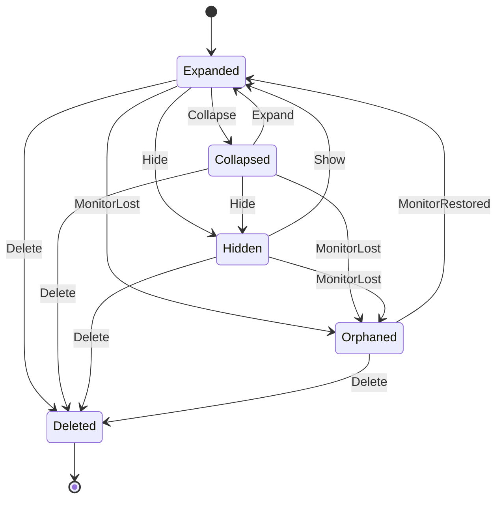
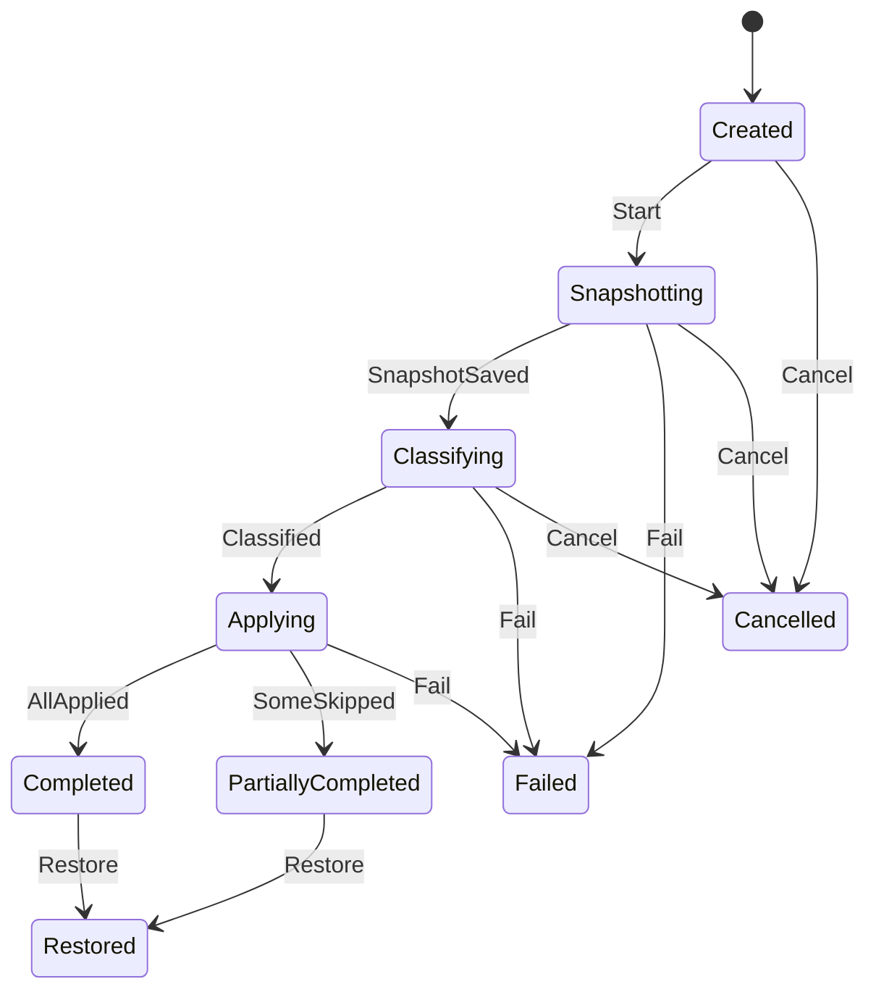

# 《DeskBox 桌面收纳》PRD v1.2

> 版本记录：v1.0 初稿 → v1.1 采纳 TDD 三处澄清 + 安全模式/应急开关/首次引导 → v1.2 开源（MIT）、SignPath 签名、winget 分发、隐私措辞修订。

## 1. 背景与目标
Windows 用户的桌面常堆满快捷方式、截图和临时文件。DeskBox 要做到：
1. 用**桌面分区方框**就地整理文件（主模式，类似 Fences，文件位置不变）；
2. 按规则**自动归类**；
3. 任何整理操作都能**一键还原**，保证不丢文件。
"移入收纳库"作为可选模式。

**成功指标（MVP）**：一键整理 ≤ 2 秒（500 个文件）；空闲内存 ≤ 80 MB、CPU ≤ 1%；文件丢失 0；还原成功率 100%。

**范围**：Win10 1809+ / Win11，仅 x64；C# / .NET 8 + WPF；免费开源（MIT），仓库公开于 `jiuyang5354/deskbox`；不做云同步；界面先中文、预留英文；对标 Fences / 腾讯桌面整理，MVP 4–6 周。

## 2. 用户故事
| ID | 角色 | 故事 | 价值 |
|---|---|---|---|
| US-1 | 办公用户 | 一键把桌面按类型归入方框 | 快速找到文件 |
| US-2 | 用户 | 整理结果不满意时一键还原 | 无后顾之忧 |
| US-3 | 用户 | 自定义规则（扩展名、关键字/正则、修改时间） | 贴合个人习惯 |
| US-4 | 用户 | 把不常用文件移入收纳库，可随时还原 | 桌面更清爽 |
| US-5 | 多屏用户 | 每个显示器分别记住方框布局，拔插后自动恢复 | 不用反复摆放 |
| US-6 | 用户 | DeskBox 出问题时仍能看到系统桌面图标 | 不会以为文件丢了 |

## 3. 状态机
### 3.1 方框（Fence）

非法流转一律拒绝（抛 `InvalidTransitionException`）。暂存方框（`is_staging=1`）不可删除。Orphaned 方框的图标显示在主屏暂存方框中。

### 3.2 一键整理任务（OrganizeJob）

必须先成功写入快照才允许动文件；Applying 阶段不可取消（由 Journal 保证原子性）。Failed / Cancelled / Restored 为终态。

## 4. 数据字典（要点）
| 实体 | 字段 | 类型 | 规则 |
|---|---|---|---|
| fence | id | GUID | 必填 |
| | title | string | 1–32 字符，去首尾空格 |
| | monitor_id | string | 显示器指纹，必填 |
| | x, y | int | 相对显示器的**物理像素** |
| | width, height | int | ≥ 120 |
| | **dpi** | int | 48–960，记录坐标时的 DPI（v1.1 新增） |
| | opacity | int | 20–100 |
| | is_staging | bool | 主屏暂存方框，不可删除 |
| fence_item | file_path | string | **全局唯一**（一个文件只属于一个方框，v1.1） |
| | file_id | string | `卷序列号(8 hex):文件ID(32 hex)` |
| | is_public_desktop | bool | 公共桌面项：可映射、可在方框间拖动，**不可移入收纳库**（v1.1） |
| rule | name / category | string | 1–32 |
| | priority | int | ≥ 0，升序匹配，首条命中 |
| | conditions | — | 扩展名、关键字、正则（100 ms 超时视为不匹配）、修改时间范围 |
| snapshot | trigger | enum | Manual / Auto / BeforeRestore；保留最近 10 份 |
| vault_record | original_path / vault_path / file_id | — | 原路径 ≠ 收纳路径；只能还原一次 |
| journal | status | enum | Pending → Committed / RolledBack |

内置规则：快捷方式（.lnk/.url）、截图（png/jpg 且文件名含 Screenshot/截图/屏幕截图）、图片、文档、压缩包、安装包（exe/msi）、文件夹、其他（未命中）。

日志中文件路径只记哈希 + 文件名。

## 5. 边界与异常矩阵
| 场景 | 处理 |
|---|---|
| 目标重名 | 跳过并提示，绝不覆盖 |
| 文件被占用 / 只读 / 需管理员 | 跳过（Locked / ReadOnly / NeedsAdmin） |
| 跨磁盘分区 | 跳过（CrossVolume），收纳库不跨分区 |
| OneDrive 仅云端文件 | 跳过（CloudOnly） |
| 文件已被删除 | 跳过（NotFound），并从方框移除 |
| 系统图标（此电脑、回收站） | 不移动，只映射 |
| 整理中途崩溃 | 启动时先按 Journal 恢复 Pending 条目 |
| Explorer 重启 | 自动重新嵌入桌面层 |
| 显示器拔出 | 方框 → Orphaned，图标进主屏暂存方框；插回后恢复 |
| **DeskBox 崩溃导致桌面为空（P0）** | 托盘提供"临时显示系统桌面图标"应急开关；**连续 2 次在启动后 30 秒内崩溃 → 自动进入安全模式**（不接管图标）并提示用户 |
| 首次启用 | 引导说明"图标由 DeskBox 显示，文件位置不会改变"，用户确认后才隐藏系统图标 |
| 卸载 | 恢复系统桌面图标，收纳库文件全部还原 |

## 6. 系统集成
- 开机自启：首次安装时让用户勾选；MSIX 用 `StartupTask`，EXE 安装包用 HKCU Run。
- 多显示器 / DPI：按显示器指纹分别记住布局。
- 检查更新：读取 GitHub Release latest 接口，稳定版 / 预览版两个通道，可在设置中关闭。

## 7. 开源、签名与分发（v1.2）
- 协议 MIT，仓库公开；首版附 README、CONTRIBUTING、PRIVACY。
- 代码签名：向 **SignPath Foundation** 申请免费开源签名，待首个内测版公开后申请；内测阶段不签名。
- 分发：GitHub Release + **winget**。
- 隐私说明：**只在检查更新时访问 GitHub，不上传任何数据，并且可以在设置里关掉。**

## 8. Gherkin 验收（节选）
```gherkin
Feature: 一键整理
  Scenario: 按内置规则归类
    Given 桌面上有 "a.lnk"、"Screenshot_01.png"、"report.docx"
    When 用户点击"一键整理"
    Then "a.lnk" 进入"快捷方式"方框
    And "Screenshot_01.png" 进入"截图"方框
    And "report.docx" 进入"文档"方框
    And 生成一份 trigger=Manual 的快照

  Scenario: 重名不覆盖
    Given 收纳库中已存在 "a.zip"
    When 用户把桌面上的 "a.zip" 移入收纳库
    Then 操作被跳过并提示，两个文件都保持原样

Feature: 一键还原
  Scenario: 还原到整理前
    Given 最近一次整理已完成
    When 用户点击"还原"
    Then 先生成 trigger=BeforeRestore 的快照
    And 所有文件和方框回到整理前状态

Feature: 安全模式
  Scenario: 连续早期崩溃
    Given DeskBox 连续 2 次在启动后 30 秒内崩溃
    When 用户再次启动 DeskBox
    Then 进入安全模式，不隐藏系统桌面图标，并提示用户

Feature: 公共桌面
  Scenario: 公共桌面项不能移入收纳库
    Given 方框中有一个来自公共桌面的项目
    When 用户尝试将其移入收纳库
    Then 操作被拒绝并提示原因
```
