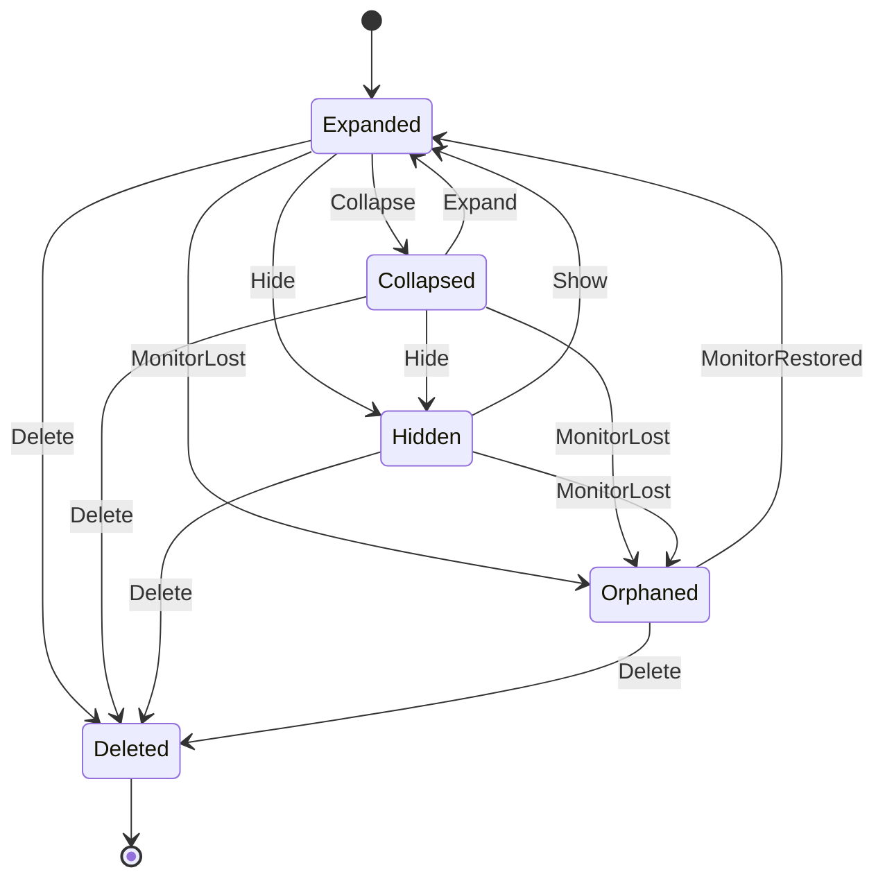
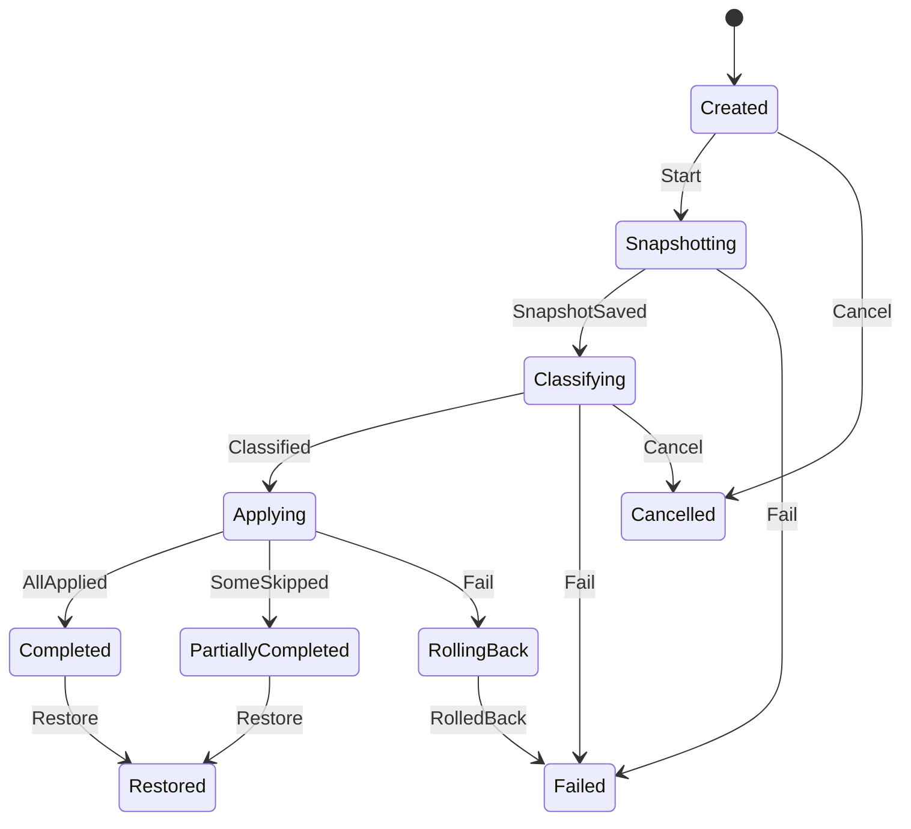

# 《DeskBox 桌面收纳》PRD v1.2.1

> 版本记录：v1.0 初稿 → v1.1 采纳 TDD 三处澄清 + 安全模式/应急开关/首次引导 → v1.2 开源（MIT）、SignPath 签名、winget 分发、隐私措辞修订 → v1.2.1 重名自动改名规则、补回遗漏用户故事、完整非功能需求、补充 Gherkin、整理任务状态机修订。

## 1. 背景与目标
Windows 用户的桌面常堆满快捷方式、截图和临时文件。DeskBox 要做到：
1. 用**桌面分区方框**就地整理文件（主模式，类似 Fences，文件位置不变）；
2. 按规则**自动归类**；
3. 任何整理操作都能**一键还原**，保证不丢文件。
"移入收纳库"作为可选模式。

**成功指标（MVP）**：一键整理 ≤ 2 秒（500 个文件）；空闲内存 ≤ 80 MB、CPU ≤ 1%；文件丢失 0；还原成功率 100%。

**范围**：Win10 1809+ / Win11，仅 x64；C# / .NET 8 + WPF；免费开源（MIT），仓库公开于 `jiuyang5354/deskbox`；不做云同步；界面先中文、预留英文；对标 Fences / 腾讯桌面整理，MVP 4–6 周。

## 2. 用户故事
| ID | 角色 | 故事 | 价值 |
|---|---|---|---|
| US-1 | 办公用户 | 一键把桌面按类型归入方框 | 快速找到文件 |
| US-2 | 用户 | 整理结果不满意时一键还原 | 无后顾之忧 |
| US-3 | 用户 | 自定义规则（扩展名、关键字/正则、修改时间） | 贴合个人习惯 |
| US-4 | 用户 | 把不常用文件移入收纳库，可随时还原 | 桌面更清爽 |
| US-5 | 多屏用户 | 每个显示器分别记住方框布局，拔插后自动恢复 | 不用反复摆放 |
| US-6 | 用户 | DeskBox 出问题时仍能看到系统桌面图标 | 不会以为文件丢了 |
| US-7（P0） | 用户 | 新建方框、命名、拖动位置、调整大小 | 按自己的方式划分桌面 |
| US-8（P1） | 用户 | 开启"实时收纳"（默认关闭）：新文件落到桌面后等待 3 秒（等写入完成）再自动归类 | 桌面始终整洁 |
| US-9（P1） | 用户 | 托盘图标常驻，并可设置开机自启（首次安装时勾选） | 随用随开 |
| US-10（P2） | 用户 | 折叠方框、调节透明度、双击桌面空白处隐藏/显示全部图标 | 需要时桌面一片干净 |

## 3. 状态机
### 3.1 方框（Fence）

非法流转一律拒绝（抛 `InvalidTransitionException`）。暂存方框（`is_staging=1`）不可删除。Orphaned 方框的图标显示在主屏暂存方框中。

### 3.2 一键整理任务（OrganizeJob）

必须先成功写入快照才允许动文件；**只能在 Classifying 阶段取消**（尚未动任何文件）；Applying 阶段不可取消；Applying 中发生致命错误时进入 RollingBack，按 Journal 回滚已移动的文件后进入 Failed。Failed / Cancelled / Restored 为终态。

## 4. 数据字典（要点）
| 实体 | 字段 | 类型 | 规则 |
|---|---|---|---|
| fence | id | GUID | 必填 |
| | title | string | 1–32 字符，去首尾空格 |
| | monitor_id | string | 显示器指纹，必填 |
| | x, y | int | 相对显示器的**物理像素** |
| | width, height | int | ≥ 120 |
| | **dpi** | int | 48–960，记录坐标时的 DPI（v1.1 新增） |
| | opacity | int | 20–100 |
| | is_staging | bool | 主屏暂存方框，不可删除 |
| fence_item | file_path | string | **全局唯一**（一个文件只属于一个方框，v1.1） |
| | file_id | string | `卷序列号(8 hex):文件ID(32 hex)` |
| | is_public_desktop | bool | 公共桌面项：可映射、可在方框间拖动，**不可移入收纳库**（v1.1） |
| rule | name / category | string | 1–32 |
| | priority | int | ≥ 0，升序匹配，首条命中 |
| | conditions | — | 扩展名、关键字、正则（100 ms 超时视为不匹配）、修改时间范围 |
| snapshot | trigger | enum | Manual / Auto / BeforeRestore；保留最近 10 份 |
| vault_record | original_path / vault_path / file_id | — | 原路径 ≠ 收纳路径；只能还原一次 |
| journal | status | enum | Pending → Committed / RolledBack |
| | actual_target_path | string | Commit 时写入实际落盘路径（自动改名后可能带 " (n)"） |

内置规则：快捷方式（.lnk/.url）、截图（png/jpg 且文件名含 Screenshot/截图/屏幕截图）、图片、文档、压缩包、安装包（exe/msi）、文件夹、其他（未命中）。

日志中文件路径只记哈希 + 文件名。

## 5. 边界与异常矩阵
| 场景 | 处理 |
|---|---|
| 目标重名 | 绝不覆盖。自动改名为 `name (n).ext`（n 从 2 到 999 依次尝试，不预先检查是否存在，以移动操作本身的"已存在"错误为准，防止竞争）；界面提示"已自动改名"；999 个名字都被占用则跳过（NameConflict）并提示 |
| 还原时原路径已被占用 | 同样自动改名为 `name (n).ext`，提示"已自动改名"，不覆盖新文件 |
| 文件被占用（共享冲突 / 锁冲突） | 跳过（Locked），其余文件继续 |
| 只读介质 / 需管理员 | 跳过（ReadOnly / NeedsAdmin） |
| 其他磁盘错误 | 跳过（IoError） |
| 路径超过 260 字符、文件名含 emoji 等 | 正常处理（长路径支持，Unicode 全支持） |
| 桌面文件超过 2000 个 | 分批处理并显示进度条 |
| 跨磁盘分区 | 跳过（CrossVolume），收纳库不跨分区 |
| OneDrive 仅云端文件 | 跳过（CloudOnly） |
| 文件已被删除 | 跳过（NotFound），并从方框移除 |
| 系统图标（此电脑、回收站） | 不移动，只映射 |
| 整理中途崩溃 | 启动时先按 Journal 恢复 Pending 条目 |
| Explorer 重启 | 自动重新嵌入桌面层 |
| 显示器拔出 | 方框 → Orphaned，图标进主屏暂存方框；插回后恢复 |
| **DeskBox 崩溃导致桌面为空（P0）** | 托盘提供"临时显示系统桌面图标"应急开关；**连续 2 次在启动后 30 秒内崩溃 → 自动进入安全模式**（不接管图标）并提示用户 |
| 首次启用 | 引导说明"图标由 DeskBox 显示，文件位置不会改变"，用户确认后才隐藏系统图标 |
| 卸载 | 恢复系统桌面图标，收纳库文件全部还原 |

## 6. 系统集成
- 开机自启：首次安装时让用户勾选；MSIX 用 `StartupTask`，EXE 安装包用 HKCU Run。
- 多显示器 / DPI：按显示器指纹分别记住布局。
- 检查更新：读取 GitHub Release latest 接口，稳定版 / 预览版两个通道，可在设置中关闭。

## 6A. 非功能需求
### 性能
- 启动到方框可见 ≤ 1.5 秒。
- 空闲内存 ≤ 80 MB，空闲 CPU ≤ 1%（空闲时除 Explorer 巡检外不轮询）。
- 一键整理 500 个文件 ≤ 2 秒；超过 2000 个文件分批执行并显示进度条，界面不卡顿。
### 兼容性
- Win10 1809+ / Win11，x64；多显示器、不同 DPI 缩放、显示器拔插。
- 路径超过 260 字符、文件名含 emoji / 生僻字均可处理。
- OneDrive 同步的桌面：仅云端文件不移动。
### 可靠性
- 文件丢失 0，还原成功率 100%；所有移动经 Journal 预写日志，崩溃后启动时先恢复。
- 绝不覆盖任何文件；重名自动改名。
- Explorer 重启后自动重新嵌入；连续 2 次启动 30 秒内崩溃进入安全模式；托盘应急开关可随时显示系统图标；崩溃和卸载后系统桌面图标必须恢复。
### 安全与隐私
- 普通用户权限运行，不请求管理员权限；需要管理员权限的文件直接跳过。
- 只在检查更新时访问 GitHub，不上传任何数据，可在设置中关闭；日志只记路径哈希 + 文件名。
### 交付
- 开源 MIT；GitHub Release 提供 MSIX 与 EXE 安装包，附 SHA256 与 SBOM；winget 上架；正式版经 SignPath 签名。
- 卸载时还原收纳库文件并恢复系统图标。

## 7. 开源、签名与分发（v1.2）
- 协议 MIT，仓库公开；首版附 README、CONTRIBUTING、PRIVACY。
- 代码签名：向 **SignPath Foundation** 申请免费开源签名，待首个内测版公开后申请；内测阶段不签名。
- 分发：GitHub Release + **winget**。
- 隐私说明：**只在检查更新时访问 GitHub，不上传任何数据，并且可以在设置里关掉。**

## 8. Gherkin 验收（节选）
```gherkin
Feature: 一键整理
  Scenario: 按内置规则归类
    Given 桌面上有 "a.lnk"、"Screenshot_01.png"、"report.docx"
    When 用户点击"一键整理"
    Then "a.lnk" 进入"快捷方式"方框
    And "Screenshot_01.png" 进入"截图"方框
    And "report.docx" 进入"文档"方框
    And 生成一份 trigger=Manual 的快照

  Scenario: 重名自动改名，不覆盖
    Given 收纳库中已存在 "notes.txt"
    When 用户把桌面上的 "notes.txt" 移入收纳库
    Then 桌面文件被保存为收纳库中的 "notes (2).txt"
    And 收纳库中原有的 "notes.txt" 内容不变
    And 界面提示"已自动改名"

  Scenario: 重名名额用尽
    Given 收纳库中 "notes.txt" 到 "notes (999).txt" 均已存在
    When 用户移入 "notes.txt"
    Then 该文件被跳过，原因为 NameConflict，并提示用户

  Scenario: 被占用的文件被跳过
    Given 桌面上的 "report.docx" 正被 Word 独占打开
    When 用户把它移入收纳库
    Then 该文件被跳过并提示"文件正在被占用"
    And 其余文件照常处理

Feature: 实时收纳
  Scenario: 新文件 3 秒后自动归类
    Given 已开启"实时收纳"（默认关闭）
    When 一个新的 "Screenshot_02.png" 出现在桌面上
    Then 等待 3 秒内无写入后，它被归入"截图"方框

Feature: 快照
  Scenario: 只保留最近 10 份
    Given 已有 10 份快照
    When 再执行一次一键整理
    Then 新快照被保存，最早的一份被删除，总数仍为 10

Feature: 多显示器
  Scenario: 拔插显示器恢复布局
    Given 副屏上有方框"工作"
    When 拔掉副屏
    Then "工作"变为 Orphaned，其图标显示在主屏暂存方框中
    When 重新插回副屏
    Then "工作"回到原位置和大小

Feature: 一键还原
  Scenario: 还原到整理前
    Given 最近一次整理已完成
    When 用户点击"还原"
    Then 先生成 trigger=BeforeRestore 的快照
    And 所有文件和方框回到整理前状态

  Scenario: 还原时原路径已被占用
    Given 桌面上已有一个新的 "notes.txt"
    When 用户把收纳库里的 "notes.txt" 还原到桌面
    Then 它被还原为 "notes (2).txt"，新文件不变，并提示"已自动改名"

Feature: 安全模式
  Scenario: 连续早期崩溃
    Given DeskBox 连续 2 次在启动后 30 秒内崩溃
    When 用户再次启动 DeskBox
    Then 进入安全模式，不隐藏系统桌面图标，并提示用户

Feature: 公共桌面
  Scenario: 公共桌面项不能移入收纳库
    Given 方框中有一个来自公共桌面的项目
    When 用户尝试将其移入收纳库
    Then 操作被拒绝并提示原因
```

> 说明：PRD v1.0 原文在交接过程中有部分截断，本文按群内可见内容和已确认的变更整理，如与原稿有出入以 PM 确认为准。
