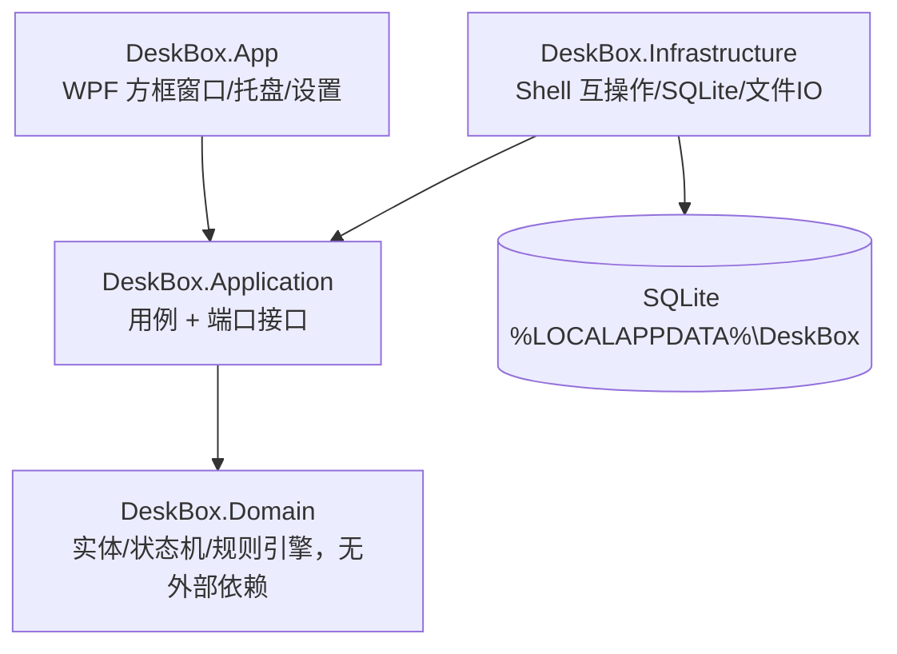

# 《DeskBox 桌面收纳》系统技术设计方案（TDD）v1.0

## 1. 技术选型
| 项 | 选型 | 理由 / 备选 |
|---|---|---|
| 语言 / 运行时 | C# / .NET 8（win-x64，ReadyToRun + 裁剪） | 原生互操作稳定；Electron 内存开销过大 |
| UI | WPF + CommunityToolkit.Mvvm | 成熟、可嵌入桌面层 |
| 托盘 | H.NotifyIcon | MIT |
| Win32 互操作 | CsWin32 | 源生成，类型安全 |
| 存储 | SQLite + Dapper | 单文件、事务、零部署 |
| 日志 | Serilog（滚动，保留 7 天） | Apache 2.0 |
| 测试 | xUnit + FluentAssertions + NSubstitute + coverlet | — |

所有依赖协议（MIT / Apache 2.0）均与 MIT 兼容。

## 2. 分层

## 3. 端口接口（Application 层）
- `IDesktopEnumerator`：枚举用户桌面与公共桌面，变化事件。
- `IFileIdentity`：卷序列号 + 128 位文件 ID。
- `IFileMover`：同分区安全移动，返回 `MoveResult`（Moved / Skipped：Locked、ReadOnly、CrossVolume、CloudOnly、NeedsAdmin、NotFound），不覆盖。
- `IJournal`：Pending → Committed / RolledBack 预写日志。
- `ISnapshotStore`：快照，保留 10 份。
- `IMonitorService`：显示器指纹、DPI、拔插事件。
- `IDesktopHost`：WorkerW 嵌入、`FWF_NOICONS` 系统图标显隐、`ExplorerRestarted` 事件。
- `IRuleEngine`：分类。

测试要求：`IFileMover`、`IJournal`、`IDesktopHost` 提供故障注入测试实现（占用、磁盘满、Pending 阶段崩溃、Explorer 重启）。

## 4. 关键机制
- **桌面嵌入**：向 Progman 发 `0x052C` 生成 WorkerW，方框窗口 `SetParent` 到其下；`FWF_NOICONS` 隐藏系统图标，改由 DeskBox 绘制。
- **Explorer 重启自愈**：每 5 秒巡检 Progman 句柄，变化即重新嵌入。
- **兜底（P0）**：托盘"临时显示系统桌面图标"；`SafeModePolicy`：连续 2 次启动后 30 秒内崩溃 → 安全模式。崩溃处理器先还原 Explorer 图标再写转储。
- **文件移动原子性**：写 Journal(Pending) → 移动 → Commit；启动时先恢复 Journal，再嵌入桌面层，最后渲染。
- **重命名跟踪**：按 `file_id` 查找记录更新 `file_path`；找不到则从方框移除。
- **显示器变化**：监听 `WM_DISPLAYCHANGE` / `WM_DPICHANGED`；指纹缺失 → Orphaned → 主屏暂存方框；重现后恢复。

## 5. 线程与性能
UI 线程只渲染；枚举、规则匹配、IO 走 `Task.Run` + `Channel<T>`。图标 LRU 缓存 512 项；`VirtualizingWrapPanel` 支持 2000+ 文件。空闲无轮询（Explorer 巡检除外）。目标启动 ≤ 1.5 s，空闲内存 ≤ 80 MB。

## 6. 可观测性
Serilog 写 `%LOCALAPPDATA%\DeskBox\logs`，每条带 `JobId` 与耗时；路径只记哈希 + 文件名。全局捕获 `DispatcherUnhandledException` 与 AppDomain 未处理异常。

## 7. 对 PRD 的澄清（已被 PM 采纳为 v1.1）
1. `fence_item.file_path` 全局唯一。
2. 坐标按"相对显示器物理像素 + 记录 DPI"存储，新增 `dpi` 字段。
3. 公共桌面项可映射、可拖动，不能移入收纳库。

## 8. 研发任务拆分
| # | 模块 | 内容 | 估时 |
|---|---|---|---|
| 1 | Domain | 实体、两个状态机、规则引擎，单测覆盖率 ≥ 90% | 3d |
| 2 | Infra | SQLite 仓储、迁移、Journal、快照存储 | 3d |
| 3 | Infra | 桌面枚举、FileId、FileMover、占用和云端文件检测 | 3d |
| 4 | Infra | WorkerW 嵌入、FWF_NOICONS、Explorer 重启自愈 | 4d |
| 5 | App | 方框窗口、自由层、拖放、右键菜单、DPI 处理 | 6d |
| 6 | App | 一键整理、还原、收纳库、实时收纳 | 4d |
| 7 | App | 多显示器、托盘、开机自启、设置 | 3d |
| 8 | 交付 | 安装包、卸载恢复、崩溃恢复 | 2d |

## 9. 交付流水线
`dotnet build` → 测试（Domain 覆盖率门禁 ≥ 90%）→ `dotnet publish`（win-x64，ReadyToRun）→ MSIX + Inno Setup EXE → 签名（SignPath，正式发布前接入）→ SHA256 + SBOM → GitHub Release 草稿，人工确认后发布。MSIX 清单 Publisher 须与证书主体一致。Shell 互操作与多屏 / DPI 集成测试在 `windows-latest` 与自托管物理机上运行。
