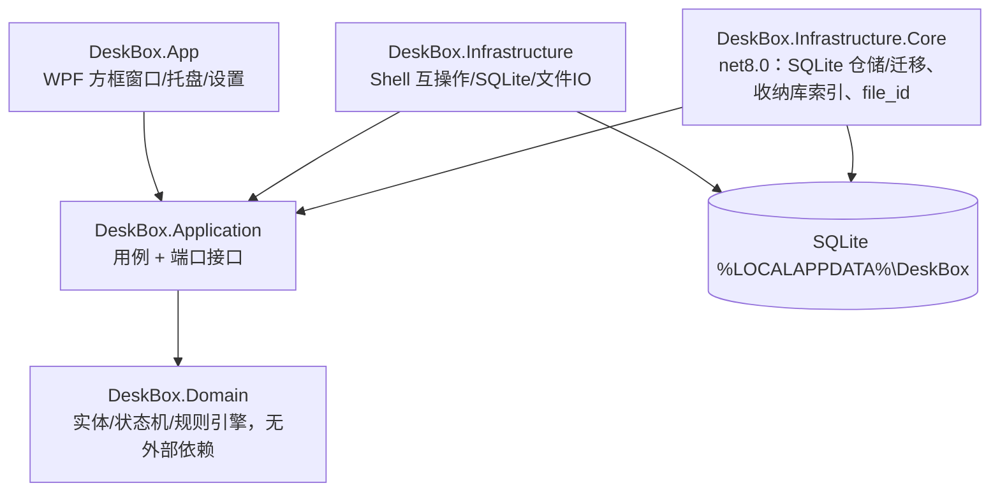

# 《DeskBox 桌面收纳》系统技术设计方案（TDD）v1.0.7

## 1. 技术选型
| 项 | 选型 | 理由 / 备选 |
|---|---|---|
| 语言 / 运行时 | C# / .NET 8（win-x64，ReadyToRun + 裁剪） | 原生互操作稳定；Electron 内存开销过大 |
| UI | WPF + CommunityToolkit.Mvvm | 成熟、可嵌入桌面层 |
| 托盘 | H.NotifyIcon | MIT |
| Win32 互操作 | CsWin32 | 源生成，类型安全 |
| 存储 | SQLite（Microsoft.Data.Sqlite 8，参数化 SQL，不用 Dapper；v1.0.6） | 单文件、事务、零部署；仓储只有十几条 SQL，手写映射可以直接调用 `JournalEntry.Restore` 做状态校验 |
| 日志 | Serilog（滚动，保留 7 天） | Apache 2.0 |
| 测试 | xUnit + FluentAssertions + NSubstitute + coverlet | — |

所有依赖协议（MIT / Apache 2.0）均与 MIT 兼容。

## 2. 分层

## 3. 端口接口（Application 层）
- `IDesktopEnumerator`：枚举用户桌面与公共桌面，变化事件。
- `IFileIdentity`：卷序列号 + 128 位文件 ID。
- `IFileMover`：同分区安全移动，返回 `MoveResult`：`Moved(Source, Target, Renamed)` 或 `Skipped(Reason)`，Reason ∈ Locked、ReadOnly、CrossVolume、CloudOnly、NeedsAdmin、NotFound、NameConflict、IoError。
- `INativeFileMove`：原生不替换移动的抽象（返回 Win32 错误码），使改名算法可在 Linux 上单测。
- `IFileSystemProbe`：读取文件属性、判断是否目录。
- `IKnownFolders`：已知文件夹；`PublicDesktop` 在 Windows 上由 `SHGetKnownFolderPath(FOLDERID_PublicDesktop)` 解析。
- `MoveResult.Skipped` 带可选 `NativeErrorCode`（原始 Win32 错误码，预检查跳过时为空）和 `AbortReason`（如 `NeedsAdmin (Win32 5)`），写入 Journal 中止原因和日志。
- `IUnitOfWork` / `IUnitOfWorkFactory`（v1.0.5）：一个 SQLite 连接上的一个事务。`CommitAsync` 提交；未提交就释放即回滚。扩展方法 `InTransactionAsync` 负责“开事务 → 执行 → 提交”。
- `IJournal`：Pending → Committed / RolledBack / Lost 预写日志。v1.0.5 起每个方法的第一个参数都是调用方传入的 `IUnitOfWork`，新增 `RecordRecoveryFailureAsync`（返回连续失败次数）。
- `IVaultRecordStore.AddAsync(uow, record)`、`ILostFileNoticeStore.AddAsync/GetUnacknowledgedAsync/SaveAsync(uow, …)`：同上。**Journal 与所有 Store 不得自行打开连接**，只在传入的工作单元上读写（Infrastructure 实现从 `IUnitOfWork` 取 `SqliteConnection` 与 `SqliteTransaction`）。`JournaledMove`、`JournalRecovery`、`LostFileNotices` 通过构造函数注入 `IUnitOfWorkFactory`。
- `ISnapshotStore`：快照，保留 10 份。
- `IMonitorService`：显示器指纹、DPI、拔插事件。
- `IDesktopHost`：WorkerW 嵌入、`FWF_NOICONS` 系统图标显隐、`ExplorerRestarted` 事件。
- `IRuleEngine`：分类。

测试要求：`IFileMover`、`IJournal`、`IDesktopHost` 提供故障注入测试实现（占用、磁盘满、Pending 阶段崩溃、Explorer 重启）。

## 4. 关键机制
- **桌面嵌入**：向 Progman 发 `0x052C` 生成 WorkerW，方框窗口 `SetParent` 到其下；`FWF_NOICONS` 隐藏系统图标，改由 DeskBox 绘制。
- **Explorer 重启自愈**：每 5 秒巡检 Progman 句柄，变化即重新嵌入。
- **兜底（P0）**：托盘"临时显示系统桌面图标"；`SafeModePolicy`：连续 2 次启动后 30 秒内崩溃 → 安全模式。崩溃处理器先还原 Explorer 图标再写转储。
- **文件移动原子性**：写 Journal(Pending) → 移动 → Commit(实际路径)；启动时先恢复 Journal，再嵌入桌面层，最后渲染。
- **重命名跟踪**：按 `file_id` 查找记录更新 `file_path`；找不到则从方框移除。
- **显示器变化**：监听 `WM_DISPLAYCHANGE` / `WM_DPICHANGED`；指纹缺失 → Orphaned → 主屏暂存方框；重现后恢复。

### 4.1 重名改名算法（RenamingFileMover，Application 层）
1. **不预先检查**目标是否存在（避免检查与移动之间的 TOCTOU 竞争），直接调用 `MoveFileExW(src, dst, 0)`：不带 `MOVEFILE_REPLACE_EXISTING`，也不带 `MOVEFILE_COPY_ALLOWED`（跨卷直接失败）。
2. 返回 `ERROR_FILE_EXISTS(80)` / `ERROR_ALREADY_EXISTS(183)` 时，依次尝试 `name (n).ext`，n = 2..999（目录不拆扩展名；`.gitignore` 类无主名文件追加在末尾）。生成改名目标前**先去掉名字末尾的点和空格**再拆扩展名（`report. ` → `report (2)`，`notes.txt. ` → `notes (2).txt`）；全由点组成的名字保持原样。源文件访问仍使用原始名字。
3. 999 仍冲突 → `Skipped(NameConflict)`。
4. 移动前预检查（命中则**不调用**原生移动，`NativeErrorCode` 为空）：
   - 源文件属性含 `FILE_ATTRIBUTE_RECALL_ON_DATA_ACCESS(0x400000)`、`RECALL_ON_OPEN(0x40000)` 或 `OFFLINE(0x1000)` → CloudOnly；
   - 源路径位于公共桌面（`FOLDERID_PublicDesktop`）之下 → NeedsAdmin。
5. 错误码映射（`NativeErrorCode` 保留原值）：

| Win32 错误码 | 含义 | SkipReason | 说明 |
|---|---|---|---|
| 80 / 183 | FILE_EXISTS / ALREADY_EXISTS | —（改名重试） | 999 次用尽 → NameConflict（记 183） |
| 32 / 33 | SHARING_VIOLATION / LOCK_VIOLATION | Locked | 仅此两种归为 Locked |
| 2 / 3 | FILE_NOT_FOUND / PATH_NOT_FOUND | NotFound | |
| 5 | ACCESS_DENIED | NeedsAdmin | 兜底；主路径为公共桌面预检查 |
| 17 | NOT_SAME_DEVICE | CrossVolume | 不带 COPY_ALLOWED，跨卷直接失败 |
| 19 | WRITE_PROTECT | ReadOnly | 写保护介质（SD 卡写保护、只读光盘等） |
| 362–406 | ERROR_CLOUD_FILE_* | CloudOnly | 兜底；主路径为属性预检查 |
| 其他 | — | IoError | |

6. 成功时 `Moved.Renamed = (n > 1)`，UI 据此提示"已自动改名"。还原到被占用的原路径走同一算法。
7. `JournaledMove`（v1.0.4，见 4.3）：Begin 时记录 file_id；每次尝试前写候选路径；成功 `Commit(actualTargetPath)`，跳过 `RollBack(abortReason)`。

### 4.3 Journal 与崩溃恢复（v1.0.4，修复 P0-1 / P1-1）
**写入顺序**
1. Begin：用 `IFileIdentity` 读取源文件 file_id（卷序列号 + 128 位文件 ID）；读不到则不移动、不记日志，返回 `Skipped(NotFound)`。写入 Pending（含 file_id、源路径、初始目标）。
2. 每次调用 `MoveFileExW` **之前**，`IFileMover` 的 `beforeAttempt` 回调把本次候选路径和尝试序号写入 Pending（`IJournal.UpdateCandidateAsync`）；改名重试时更新。因此在任意一次尝试前后被杀，Pending 中的候选路径都指向唯一可能的落点。
3. 成功 → `Commit(实际路径)`；跳过 → `RollBack("Locked (Win32 32)" 等)`。

**取消与异常（P1-1）**：`JournaledMove` 捕获 `OperationCanceledException` 及探测异常：
- 能证明未移动 —— 尚未发起任何原生尝试，或源路径 file_id 仍是它且候选路径不是它 —— 立即 `RollBack("Cancelled" / "Interrupted (异常类型)"，带 ", verified not moved")`；
- 无法证明（含验证时探测再次失败）—— 保留 Pending，写结构化日志 `IRecoveryLog.UncertainPending(EntryId, JobId, FileId, SourcePath, CandidatePath, Attempt, ExceptionType, Message)`，交给下次启动恢复。异常继续向上抛出。

**启动恢复 `JournalRecovery`**（先于桌面层嵌入），对每条 Pending 按 file_id：
| 检查 | 结果 |
|---|---|
| 源路径的 file_id 匹配 | `RollBack("Recovered: source intact")`（Abort） |
| 候选路径的 file_id 匹配 | 写 `vault_record` + `Commit(候选路径)` |
| 扫描收纳库（`IVaultIndex`），按 file_id 匹配 | 写 `vault_record` + `Commit(找到的路径)`；同名但 file_id 不同的已有文件不会被误认 |
| 都找不到 | `MarkLost`（新状态 Lost，终态），写入持久的 `LostFileNotice` |

`LostFileNotice` 每次启动都会提示，直到用户确认（`LostFileNotices.AcknowledgeAllAsync`）。文案（Strings.resx 键 `LostFilesNotice`）：
> 有 {0} 个文件在上次整理中断后没能找回：{1}。它可能已被移动或删除，你可以在收纳库和桌面上搜索这个文件名。

{1} 为文件名列表，以"、"分隔。

### 4.2.1 桌面枚举与云端 / 占用检测（v1.0.7，任务 3）
- `DesktopEnumerator`（Application）只列用户桌面与公共桌面的**直接子项**；按 `file_id`（OrdinalIgnoreCase）去重，非法 `file_id` 跳过；某个桌面列举失败不影响另一个。
- `WindowsDirectoryLister`（Infrastructure.Core）：以 `FILE_LIST_DIRECTORY | FILE_FLAG_BACKUP_SEMANTICS` 打开**目录**句柄，`GetFileInformationByHandleEx(FileIdExtdDirectoryInfo)` 一次取名字 / 属性 / 128 位 file_id / 修改时间，**不打开任何子项**、不跟随联接点 / 符号链接目录（它们作为项列出，`IsReparsePoint=true`）。路径经 `Win32PathNormalizer`（`\\?\` 前缀）。
- 云端文件：仅凭属性位 `RECALL_ON_DATA_ACCESS(0x400000) | RECALL_ON_OPEN(0x40000) | OFFLINE(0x1000)` 判定；`JournaledMove` 在读取 file_id（会打开文件）之前先检查，命中直接 `Skipped(CloudOnly)`，不写 Journal。
- 占用：不预先打开探测，由 `MoveFileExW` 返回 32 / 33 映射为 `Locked`；跨分区 17 → `CrossVolume`，不带 `MOVEFILE_COPY_ALLOWED`、不重试。
- 顺序不变：
  1. 事务 1（`BEGIN IMMEDIATE`）：查重 + 插入 Pending，**提交**；
  2. 每次尝试前，事务 2：写入候选路径，**提交**；
  3. `MoveFileExW`——**在任何事务之外执行**，此时 Pending 行（含候选路径）已经落盘；
  4. 标记完成（journal status Pending→Committed，在移动之后的独立事务中）；跳过则在独立事务中 Pending→RolledBack。
  若进程在第 3 步之后、第 4 步之前崩溃，启动恢复按 file_id 在候选路径找到文件并补做标记完成（见 4.3；测试 `CrashAfterMoveTests`）。
- 监听：`FileSystemDirectoryWatcher`（不含子目录）。

### 4.3.1 恢复流程自身的原子性与隔离（v1.0.5，修复 P1-2 / P1-3 / P2-3）
- **同一事务**：每条 Pending 的“写业务表 + 改 Journal 状态”放进一个 SQLite 事务提交——补提交为 `vault_record` 加 `Commit`；标记丢失为先写 `LostFileNotice` 再 `MarkLost`；回滚只有 `RollBack`。中途崩溃时，要么两步都没发生（下次启动这条仍是 Pending，重新判断），要么两步都完成，不会出现“已有 vault_record 但仍 Pending”（P1-2，重启时撞 `vault_path` UNIQUE 而卡死）或“已 Lost 但没有提示”（P1-3）。`vault_record.vault_path` 与 `lost_file_notice.journal_entry_id` 的唯一约束保留，作为防御。
- **按条隔离（P2-3）**：读取 file_id、扫描收纳库或写库时抛出的任何异常（`OperationCanceledException` 除外）只影响当前这一条：它保持 Pending，结果为 `RecoveryOutcome.Failed`，然后继续处理下一条。
- **连续失败 3 次转 Lost**：失败时在新事务里执行 `RecordRecoveryFailureAsync`（`journal.recovery_failures` +1）。达到 `JournalEntry.MaxRecoveryFailures = 3` 时，在**同一事务**里写入提示并执行 MarkLost，结果为 `Lost`。如果连计数都写不进去（例如磁盘故障），就不改动任何数据，下次启动再试。
- **结构化日志**：`IRecoveryLog.RecoveryFailed(EntryId, JobId, FileId, SourcePath, CandidatePath, ConsecutiveFailures, MarkedLost, ExceptionType, Message)`。
- **DDL 增量**：`journal` 表新增 `recovery_failures INTEGER NOT NULL DEFAULT 0`，含义是恢复连续失败的次数。
- **测试**：用 `FakeDb` 模拟事务，暂存的写入只在提交时生效。对恢复流程的每一步（开始事务、每次读写、提交）各注入一次“进程被杀”，然后重启并再跑恢复。验证：不抛异常；最终状态与不崩溃时一致；每条 Committed 恰好对应一条 vault_record，每条 Lost 恰好对应一条提示；失败计数不受被杀影响。另外覆盖：一条失败不阻塞其他条；收纳库扫描异常；连续 3 次失败后转 Lost；第 3 次失败的事务在提交时被杀，结果仍是全有或全无；取消不会被吞掉。

### 4.3.2 Windows 路径规则（v1.0.5）
Domain 与 Application 层禁止使用 `System.IO.Path`，因为它的行为随宿主系统变化，测试在 Linux 和 windows-2022 上会得到不同结果。路径的拼接与拆分统一使用 Domain 层的 `WinPath`，规则固定为 Windows：
- `\` 和 `/` 都算分隔符；
- 能识别盘符根 `C:\`、`C:`、UNC 根 `\\server\share\`，以及 `\\?\`、`\\?\UNC\` 前缀；
- 比较不区分大小写（`PathEquals`、`Comparer`）；
- 拼接一律使用 `\`。

测试数据统一写成 `C:\v\...` 的形式。

**测试（v1.0.4）**：杀进程模拟覆盖第 1–4 次尝试的移动前 / 移动后（共 8 种），验证恢复结果分别为 Abort / Commit 到候选路径，且已有同名文件不被改动；另覆盖收纳库扫描、Lost 提示持久与确认、取消与探测异常。

### 4.1.1 路径规范化（v1.0.3）
所有传给 Win32 文件 API（`MoveFileExW`、`GetFileAttributesW` 等）的路径都必须经过 `Win32PathNormalizer.Normalize`（Application 层纯函数，可在 Linux 上测试）：
- `C:\a\b` → `\\?\C:\a\b`；`\\server\share\a` → `\\?\UNC\server\share\a`，从而支持超过 260 字符的路径；
- 已带 `\\?\` 或 `\\.\` 前缀的路径原样返回；
- 只接受盘符绝对路径或 UNC 路径，`a\b`、`C:a`、`\a` 等相对路径直接拒绝，**绝不依赖当前工作目录**；
- `/` 统一为 `\`，合并重复分隔符，解析 `.` / `..`（越过根目录则拒绝）；
- **保留文件名末尾的空格和点**（如 `report. `、`a .`）：带前缀后 Win32 不再隐式裁剪，否则会操作到另一个文件；
- Unicode / emoji 文件名原样保留（UTF-16 传参）。

### 4.1.2 跳过原因文案
界面文案集中在 `DeskBox.Application/Resources/Strings.resx`（默认 zh-CN，键为 `SkipReason` 枚举名），通过 `SkipReasonText.Get` 读取；单测保证每个枚举值都有文案。日志与 Journal 仍使用 `Skipped.AbortReason`（如 `NeedsAdmin (Win32 5)`）。

### 4.2 整理任务状态机修订
- `Cancel` 只允许在 Classifying（尚未动文件）；Created / Snapshotting / Applying 均不可取消。
- Applying 中致命错误：Applying →(Fail)→ RollingBack →(RolledBack)→ Failed。
- 方框状态机（含 Deleted 终态）不变，已被 PM 接受。

### 4.4 SQLite 持久化（v1.0.6，DeskBox.Infrastructure.Core）
`DeskBox.Infrastructure.Core` 目标框架为 `net8.0`，不依赖 WPF，所以集成测试能在任何宿主上对真实 SQLite 文件运行。Windows 专用的部分用 `[SupportedOSPlatform("windows")]` 标注。

#### 4.4.1 连接、PRAGMA 与事务（架构要求）
- **一个工作单元 = 一个连接 + 一个事务。**`SqliteUnitOfWorkFactory.BeginAsync` 每次新开一个连接，并且关闭连接池（`Pooling=False`），所以连接不会被其他工作单元或线程复用。同一个工作单元也不能被并发使用：同时执行两条命令会直接抛 `InvalidOperationException`。
- **每次打开连接都执行以下 PRAGMA**，依次为：
  1. `busy_timeout=5000`
  2. `journal_mode=WAL`（返回值不是 `wal` 就拒绝启动）
  3. `synchronous=FULL`
  4. `foreign_keys=ON`

  除 WAL 外，其余都是连接级设置，不会被新连接继承，所以必须每次都设。
- **事务一律 `BEGIN IMMEDIATE`。**开事务时就拿写锁，等锁由 `busy_timeout` 处理，避免在事务中途从读锁升级为写锁时遇到 SQLITE_BUSY。驱动层还会按 `Default Timeout=30s` 重试。
- **释放时未提交就回滚。**`CommitAsync` 只能调用一次；已结束的工作单元不能再执行命令。
- **仓储不得自行打开连接。**所有仓储只能通过 `SqliteUnitOfWork.From(uow)` 取得当前连接和事务，传入其他类型的工作单元会抛 `ArgumentException`。
- **SQL 全部参数化。**状态值只使用枚举名常量。

#### 4.4.2 DDL（迁移 v1，版本号记在 `PRAGMA user_version`）
- `journal`
  - 列：`id` TEXT PK、`job_id`、`file_id`（大写）、`source_path`、`target_path`、`attempt` INTEGER ≥ 0、`status`、`actual_target_path` NULL、`abort_reason` NULL、`recovery_failures` INTEGER NOT NULL DEFAULT 0 ≥ 0、`created_at`（ISO 8601，含时区）。
  - `status` 带 CHECK 约束，取值为 Pending / Committed / RolledBack / Lost。
  - 索引 `ix_journal_status`；部分唯一索引 `ux_journal_pending_file_id ON journal(file_id) WHERE status='Pending'`，同一文件同时最多一条 Pending。
- `vault_record`
  - 列：`id` PK、`original_path` COLLATE NOCASE、`vault_path` COLLATE NOCASE、`file_id`、`moved_at`、`restored_at` NULL。
  - 部分唯一索引 `ux_vault_record_vault_path ON vault_record(vault_path) WHERE restored_at IS NULL`：只约束仍在库中的记录，还原后同一路径可以再次收纳；按路径查询时优先返回在库中的记录。普通索引 `ix_vault_record_file_id`。
- `lost_file_notice`
  - 列：`journal_entry_id` PK，外键引用 `journal(id)`；`file_id`、`original_path`、`detected_at`、`acknowledged_at` NULL。
  - 索引 `ix_lost_file_notice_unack`。
- `snapshot`
  - 列：`id` PK、`trigger_kind`（CHECK：Manual / Auto / BeforeRestore）、`created_at`。
  - 索引 `ix_snapshot_created_at`。
- `snapshot_entry`
  - 列：`snapshot_id`，外键引用 `snapshot(id)`，ON DELETE CASCADE；`ordinal`、`file_id`、`file_path`、`fence_id` NULL、`x`、`y`。
  - 主键 (`snapshot_id`, `ordinal`)。

**时间格式**：所有时间列都以 UTC 文本保存，格式固定为 `yyyy-MM-ddTHH:mm:ss.fffZ`（定长，所以按文本排序就是按时间排序）。统一由 `SqliteTime.Format` / `SqliteTime.Parse` 处理：写入时先转成 UTC，并截断到毫秒；读出的值 Offset 为 0。

**AlreadyInProgress**
- **先查后写，同一事务**：在 Begin 阶段、调用 MoveFileExW 之前，`JournaledMove` 在同一个 `BEGIN IMMEDIATE` 事务里依次执行：
  1. `IJournal.HasPendingAsync(uow, fileId)`，即 `SELECT 1 FROM journal WHERE file_id = upper(?) AND status = 'Pending'`。file_id 一律以大写保存，所以这等价于 OrdinalIgnoreCase 比较，并且能用上部分索引。
  2. 已有 Pending 时直接返回 `Skipped(AlreadyInProgress)`，`AbortReason` 为 "AlreadyInProgress"；否则执行 `AppendPendingAsync` 写入 Pending。
- **为什么不会有竞争**：`BEGIN IMMEDIATE` 一开事务就持有写锁，两个进程同时 Begin 同一文件时会被串行化，后到的一方一定能查到先到的那条 Pending。
- **不是错误**：跳过时不移动文件，不写日志，也不改动另一条 Pending。
- **唯一冲突一律按错误抛出**：`AppendPendingAsync` 是普通 INSERT，任何唯一约束冲突都作为 `SqliteException` 抛出，包括绕过预检查直接插入时撞上 `ux_journal_pending_file_id`（2067）和主键冲突（1555）。不再根据错误消息判断冲突，也不再使用 SAVEPOINT 或 `JournalConflictException`。部分唯一索引只作为最后一道防线。
- **测试**：
  - 结构测试：journal 上唯一一个包含 file_id 的唯一索引就是这个部分索引；
  - 已有 Pending 时返回 AlreadyInProgress；
  - 绕过预检查直接插入会抛异常；
  - 两个 `DeskBox.SqliteWriter` 子进程同时 Begin 同一 file_id：最终恰好一条 Pending，另一方得到 AlreadyInProgress，两边都没有错误。
- 用户文案在 Strings.resx 中，键为 `AlreadyInProgress`，值为“这个文件正在整理中，已跳过”（PRD v1.2.3）。

**迁移规则**
- 数据库尚未发布，v1.0.6 的评审修改（两个部分唯一索引、NOCASE、UTC 时间格式）直接改写迁移 v1，不另加迁移版本。发布之后，任何结构变化都必须作为新的迁移追加。
- `SqliteSchema.MigrateAsync` 在 `BEGIN IMMEDIATE` 事务里先读版本，再逐个执行迁移并提升版本号。两个进程同时启动时，后到的那个会等先到的提交后再读版本，因此可以重复调用。
- 数据库版本高于程序支持的版本时拒绝启动。

#### 4.4.3 其他实现
- `ISnapshotStore` 也改为接收 `IUnitOfWork`，删除一份快照会级联删除它的所有条目。
- `IVaultIndex` 由 `VaultDirectoryIndex` 实现：递归枚举收纳库里的文件和文件夹，跳过无权访问的目录和重解析点。
- `IFileIdentity` 由 `WindowsFileIdentity` 实现：用 `CreateFileW` 以只读属性、全共享、`FILE_FLAG_BACKUP_SEMANTICS | OPEN_REPARSE_POINT` 打开，再用 `GetFileInformationByHandleEx(FileIdInfo)` 读取，格式化为 `卷序列号8位:文件ID32位`。

#### 4.4.4 测试
集成测试使用临时目录下的真实数据库文件，覆盖：
- 每个连接上 PRAGMA 是否生效；
- `BEGIN IMMEDIATE` 一开始就拿写锁：另一连接立刻遇到 SQLITE_BUSY；
- 未提交释放时回滚，事务内出异常时整体回滚；
- 已结束或并发使用的工作单元被拒绝；
- 每个仓储的往返读写、状态必须为 Pending 的约束、UNIQUE / 主键 / 外键 / CHECK 约束、快照级联删除；
- `JournalRecovery` 跑在 SQLite 上的端到端流程：补提交、标记 Lost、UNIQUE 冲突时整条回滚，以及连续 3 次失败后转 Lost；
- **双进程并发写**：测试进程和子进程 `DeskBox.SqliteWriter` 同时各写 150 条（每条两个事务）。要求子进程没有任何异常（包括 SQLITE_BUSY）、`PRAGMA integrity_check` = ok、记录条数精确。

`WindowsFileIdentity` 的测试只在 Windows 上运行：验证改名（含末尾空格或点）后 file_id 不变、不同文件的 file_id 不同、目录也有 file_id。

## 5. 线程与性能
UI 线程只渲染；枚举、规则匹配、IO 走 `Task.Run` + `Channel<T>`。图标 LRU 缓存 512 项；`VirtualizingWrapPanel` 支持 2000+ 文件。空闲无轮询（Explorer 巡检除外）。目标启动 ≤ 1.5 s，空闲内存 ≤ 80 MB。

## 6. 可观测性
Serilog 写 `%LOCALAPPDATA%\DeskBox\logs`，每条带 `JobId` 与耗时；路径只记哈希 + 文件名。全局捕获 `DispatcherUnhandledException` 与 AppDomain 未处理异常。

## 7. 对 PRD 的澄清（已被 PM 采纳为 v1.1）
1. `fence_item.file_path` 全局唯一。
2. 坐标按"相对显示器物理像素 + 记录 DPI"存储，新增 `dpi` 字段。
3. 公共桌面项可映射、可拖动，不能移入收纳库。

## 8. 研发任务拆分
| # | 模块 | 内容 | 估时 |
|---|---|---|---|
| 1 | Domain | 实体、两个状态机、规则引擎，单测覆盖率 ≥ 90% | 3d |
| 2 | Infra | SQLite 仓储、迁移、Journal、快照存储 | 3d |
| 3 | Infra | 桌面枚举、FileId、FileMover、占用和云端文件检测 | 3d |
| 4 | Infra | WorkerW 嵌入、FWF_NOICONS、Explorer 重启自愈 | 4d |
| 5 | App | 方框窗口、自由层、拖放、右键菜单、DPI 处理 | 6d |
| 6 | App | 一键整理、还原、收纳库、实时收纳 | 4d |
| 7 | App | 多显示器、托盘、开机自启、设置 | 3d |
| 8 | 交付 | 安装包、卸载恢复、崩溃恢复 | 2d |

## 9. 交付流水线
`dotnet build` → 测试（Domain 覆盖率门禁 ≥ 90%）→ `dotnet publish`（win-x64，ReadyToRun）→ MSIX + Inno Setup EXE → 签名（SignPath，正式发布前接入）→ SHA256 + SBOM → GitHub Release 草稿，人工确认后发布。MSIX 清单 Publisher 须与证书主体一致。Shell 互操作与多屏 / DPI 集成测试在 `windows-latest` 与自托管物理机上运行。
