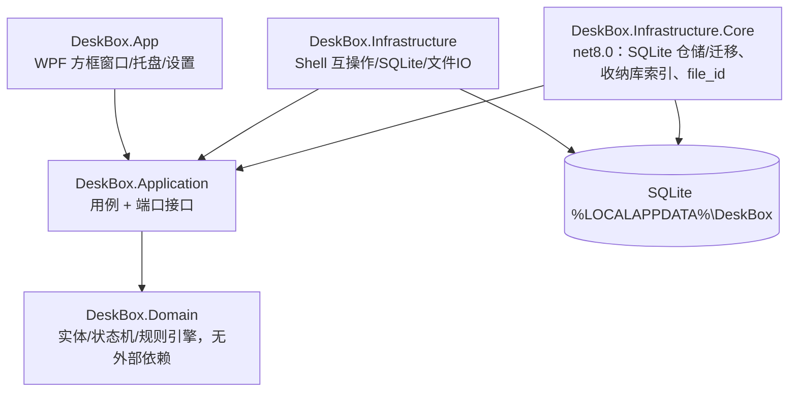

# 《DeskBox 桌面收纳》系统技术设计方案（TDD）v1.0.14

> v1.0.14：P0 启动对账——§4.5.5 改为「启动对账」，桌面文件收进暂存方框、清理磁盘上已不存在的归属，扫描不完整时一行不删（对应 PRD v1.2.8 §7B）。

> v1.0.13：P0 修复——Win11 24H2/25H2 上方框看不见。§4.5.1 按窗口结构判断层级并加挂载后校验；§4.5.3 兼容显示钉在最底；§4.5.5 启动扫描日志与 fence_item 为空的调查；§6 落盘日志。

## 1. 技术选型
| 项 | 选型 | 理由 / 备选 |
|---|---|---|
| 语言 / 运行时 | C# / .NET 8（win-x64，ReadyToRun + 裁剪） | 原生互操作稳定；Electron 内存开销过大 |
| UI | WPF + CommunityToolkit.Mvvm | 成熟、可嵌入桌面层 |
| 托盘 | H.NotifyIcon | MIT |
| Win32 互操作 | CsWin32 | 源生成，类型安全 |
| 存储 | SQLite（Microsoft.Data.Sqlite 8，参数化 SQL，不用 Dapper；v1.0.6） | 单文件、事务、零部署；仓储只有十几条 SQL，手写映射可以直接调用 `JournalEntry.Restore` 做状态校验 |
| 日志 | Serilog（滚动，保留 7 天） | Apache 2.0 |
| 测试 | xUnit + FluentAssertions + NSubstitute + coverlet | — |

所有依赖协议（MIT / Apache 2.0）均与 MIT 兼容。

## 2. 分层

## 3. 端口接口（Application 层）
- `IDesktopEnumerator`：枚举用户桌面与公共桌面，变化事件。
- `IFileIdentity`：卷序列号 + 128 位文件 ID。
- `IFileMover`：同分区安全移动，返回 `MoveResult`：`Moved(Source, Target, Renamed)` 或 `Skipped(Reason)`，Reason ∈ Locked、ReadOnly、CrossVolume、CloudOnly、NeedsAdmin、NotFound、NameConflict、IoError。
- `INativeFileMove`：原生不替换移动的抽象（返回 Win32 错误码），使改名算法可在 Linux 上单测。
- `IFileSystemProbe`：读取文件属性、判断是否目录。
- `IKnownFolders`：已知文件夹；`PublicDesktop` 在 Windows 上由 `SHGetKnownFolderPath(FOLDERID_PublicDesktop)` 解析。
- `MoveResult.Skipped` 带可选 `NativeErrorCode`（原始 Win32 错误码，预检查跳过时为空）和 `AbortReason`（如 `NeedsAdmin (Win32 5)`），写入 Journal 中止原因和日志。
- `IUnitOfWork` / `IUnitOfWorkFactory`（v1.0.5）：一个 SQLite 连接上的一个事务。`CommitAsync` 提交；未提交就释放即回滚。扩展方法 `InTransactionAsync` 负责“开事务 → 执行 → 提交”。
- `IJournal`：Pending → Committed / RolledBack / Lost 预写日志。v1.0.5 起每个方法的第一个参数都是调用方传入的 `IUnitOfWork`，新增 `RecordRecoveryFailureAsync`（返回连续失败次数）。
- `IVaultRecordStore.AddAsync(uow, record)`、`ILostFileNoticeStore.AddAsync/GetUnacknowledgedAsync/SaveAsync(uow, …)`：同上。**Journal 与所有 Store 不得自行打开连接**，只在传入的工作单元上读写（Infrastructure 实现从 `IUnitOfWork` 取 `SqliteConnection` 与 `SqliteTransaction`）。`JournaledMove`、`JournalRecovery`、`LostFileNotices` 通过构造函数注入 `IUnitOfWorkFactory`。
- `ISnapshotStore`：快照，保留 10 份。
- `IMonitorService`：显示器指纹、DPI、拔插事件。
- `IDesktopWindowing` / `IShellNotifications` / `IBoxWindows` / `IFenceStore` / `IMonitorService`：桌面层嵌入与自愈（v1.0.8，见 4.5；取代原 `IDesktopHost`）。`FWF_NOICONS` 系统图标显隐不在任务 4 范围内，另行设计。
- `IRuleEngine`：分类。

测试要求：`IFileMover`、`IJournal`、`IDesktopWindowing` 提供故障注入测试实现（占用、磁盘满、Pending 阶段崩溃、Explorer 重启）。

## 4. 关键机制
- **桌面嵌入**：向 Progman 发 `0x052C` 生成 WorkerW，方框窗口 `SetParent` 到其下；`FWF_NOICONS` 隐藏系统图标，改由 DeskBox 绘制。
- **Explorer 重启自愈**：监听 `TaskbarCreated` 广播（v1.0.8 起取代 5 秒巡检，见 4.5）。
- **兜底（P0）**：托盘"临时显示系统桌面图标"；`SafeModePolicy`：连续 2 次启动后 30 秒内崩溃 → 安全模式。崩溃处理器先还原 Explorer 图标再写转储。
- **文件移动原子性**：写 Journal(Pending) → 移动 → Commit(实际路径)；启动时先恢复 Journal，再嵌入桌面层，最后渲染。
- **重命名跟踪**：按 `file_id` 查找记录更新 `file_path`；找不到则从方框移除。
- **显示器变化**：监听 `WM_DISPLAYCHANGE` / `WM_DPICHANGED`；指纹缺失 → 整个方框临时挪到主屏工作区显示（不落库）；重现后按数据库原记录恢复（见 4.5.2）。v1.0.9 起删除 `Orphaned` 状态及 `MonitorLost` / `MonitorRestored` 触发器。 方框状态从未落库（`fence` 表无状态列，迁移 v1/v2 里也没有任何 Orphaned 值或约束），所以无需数据迁移，也不新增迁移版本。

### 4.1 重名改名算法（RenamingFileMover，Application 层）
1. **不预先检查**目标是否存在（避免检查与移动之间的 TOCTOU 竞争），直接调用 `MoveFileExW(src, dst, 0)`：不带 `MOVEFILE_REPLACE_EXISTING`，也不带 `MOVEFILE_COPY_ALLOWED`（跨卷直接失败）。
2. 返回 `ERROR_FILE_EXISTS(80)` / `ERROR_ALREADY_EXISTS(183)` 时，依次尝试 `name (n).ext`，n = 2..999（目录不拆扩展名；`.gitignore` 类无主名文件追加在末尾）。生成改名目标前**先去掉名字末尾的点和空格**再拆扩展名（`report. ` → `report (2)`，`notes.txt. ` → `notes (2).txt`）；全由点组成的名字保持原样。源文件访问仍使用原始名字。
3. 999 仍冲突 → `Skipped(NameConflict)`。
4. 移动前预检查（命中则**不调用**原生移动，`NativeErrorCode` 为空）：
   - 源文件属性含 `FILE_ATTRIBUTE_RECALL_ON_DATA_ACCESS(0x400000)`、`RECALL_ON_OPEN(0x40000)` 或 `OFFLINE(0x1000)` → CloudOnly；
   - 源路径位于公共桌面（`FOLDERID_PublicDesktop`）之下 → NeedsAdmin；
   - 源与目标不同卷（`WinPath.IsCrossVolume`，比较盘符 / UNC `server\share`）→ CrossVolume，**不复制**。
5. 错误码映射（`NativeErrorCode` 保留原值）：

| Win32 错误码 | 含义 | SkipReason | 说明 |
|---|---|---|---|
| 80 / 183 | FILE_EXISTS / ALREADY_EXISTS | —（改名重试） | 999 次用尽 → NameConflict（记 183） |
| 32 / 33 | SHARING_VIOLATION / LOCK_VIOLATION | Locked | 仅此两种归为 Locked |
| 2 / 3 | FILE_NOT_FOUND / PATH_NOT_FOUND | NotFound | |
| 5 | ACCESS_DENIED | NeedsAdmin | 兜底；主路径为公共桌面预检查 |
| 17 | NOT_SAME_DEVICE | CrossVolume | 兜底；主路径为 `WinPath.IsCrossVolume` 预检查；不带 COPY_ALLOWED |
| 19 | WRITE_PROTECT | ReadOnly | 写保护介质（SD 卡写保护、只读光盘等） |
| 362–406 | ERROR_CLOUD_FILE_* | CloudOnly | 兜底；主路径为属性预检查 |
| 其他 | — | IoError | |

6. 成功时 `Moved.Renamed = (n > 1)`，UI 据此提示"已自动改名"。还原到被占用的原路径走同一算法。
7. `JournaledMove`（v1.0.4，见 4.3）：Begin 时记录 file_id；每次尝试前写候选路径；成功 `Commit(actualTargetPath)`，跳过 `RollBack(abortReason)`。

### 4.3 Journal 与崩溃恢复（v1.0.4，修复 P0-1 / P1-1）
**写入顺序**
1. Begin：用 `IFileIdentity` 读取源文件 file_id（卷序列号 + 128 位文件 ID）；读不到则不移动、不记日志，返回 `Skipped(NotFound)`。写入 Pending（含 file_id、源路径、初始目标）。
2. 每次调用 `MoveFileExW` **之前**，`IFileMover` 的 `beforeAttempt` 回调把本次候选路径和尝试序号写入 Pending（`IJournal.UpdateCandidateAsync`）；改名重试时更新。因此在任意一次尝试前后被杀，Pending 中的候选路径都指向唯一可能的落点。
3. 成功 → `Commit(实际路径)`；跳过 → `RollBack("Locked (Win32 32)" 等)`。

**取消与异常（P1-1）**：`JournaledMove` 捕获 `OperationCanceledException` 及探测异常：
- 能证明未移动 —— 尚未发起任何原生尝试，或源路径 file_id 仍是它且候选路径不是它 —— 立即 `RollBack("Cancelled" / "Interrupted (异常类型)"，带 ", verified not moved")`；
- 无法证明（含验证时探测再次失败）—— 保留 Pending，写结构化日志 `IRecoveryLog.UncertainPending(EntryId, JobId, FileId, SourcePath, CandidatePath, Attempt, ExceptionType, Message)`，交给下次启动恢复。异常继续向上抛出。

**启动恢复 `JournalRecovery`**（先于桌面层嵌入），对每条 Pending 按 file_id：
| 检查 | 结果 |
|---|---|
| 源路径的 file_id 匹配 | `RollBack("Recovered: source intact")`（Abort） |
| 候选路径的 file_id 匹配 | 写 `vault_record` + `Commit(候选路径)` |
| 扫描收纳库（`IVaultIndex`），按 file_id 匹配 | 写 `vault_record` + `Commit(找到的路径)`；同名但 file_id 不同的已有文件不会被误认 |
| 都找不到 | `MarkLost`（新状态 Lost，终态），写入持久的 `LostFileNotice` |

`LostFileNotice` 每次启动都会提示，直到用户确认（`LostFileNotices.AcknowledgeAllAsync`）。文案（Strings.resx 键 `LostFilesNotice`）：
> 有 {0} 个文件在上次整理中断后没能找回：{1}。它可能已被移动或删除，你可以在收纳库和桌面上搜索这个文件名。

{1} 为文件名列表，以"、"分隔。

### 4.2.1 桌面枚举与云端 / 占用检测（v1.0.7，任务 3）
- `DesktopEnumerator`（Application）只列用户桌面与公共桌面的**直接子项**；按 `file_id`（OrdinalIgnoreCase）去重，非法 `file_id` 跳过；某个桌面列举失败不影响另一个。
- `WindowsDirectoryLister`（Infrastructure.Core）：以 `FILE_LIST_DIRECTORY | FILE_FLAG_BACKUP_SEMANTICS` 打开**目录**句柄，`GetFileInformationByHandleEx(FileIdExtdDirectoryInfo)` 一次取名字 / 属性 / 128 位 file_id / 修改时间，**不打开任何子项**、不跟随联接点 / 符号链接目录（它们作为项列出，`IsReparsePoint=true`）。路径经 `Win32PathNormalizer`（`\\?\` 前缀）。
- 云端文件：仅凭属性位 `RECALL_ON_DATA_ACCESS(0x400000) | RECALL_ON_OPEN(0x40000) | OFFLINE(0x1000)` 判定；`JournaledMove` 在读取 file_id（会打开文件）之前先检查，命中直接 `Skipped(CloudOnly)`，不写 Journal。
- 占用：不预先打开探测，由 `MoveFileExW` 返回 32 / 33 映射为 `Locked`；跨分区 17 → `CrossVolume`，不带 `MOVEFILE_COPY_ALLOWED`、不重试。
- 顺序不变：
  1. 事务 1（`BEGIN IMMEDIATE`）：查重 + 插入 Pending，**提交**；
  2. 每次尝试前，事务 2：写入候选路径，**提交**；
  3. `MoveFileExW`——**在任何事务之外执行**，此时 Pending 行（含候选路径）已经落盘；
  4. 标记完成（journal status Pending→Committed，在移动之后的独立事务中）；跳过则在独立事务中 Pending→RolledBack。
  若进程在第 3 步之后、第 4 步之前崩溃，启动恢复按 file_id 在候选路径找到文件并补做标记完成（见 4.3；测试 `CrashAfterMoveTests`）。
- 监听：`FileSystemDirectoryWatcher`（不含子目录）。

### 4.3.1 恢复流程自身的原子性与隔离（v1.0.5，修复 P1-2 / P1-3 / P2-3）
- **同一事务**：每条 Pending 的“写业务表 + 改 Journal 状态”放进一个 SQLite 事务提交——补提交为 `vault_record` 加 `Commit`；标记丢失为先写 `LostFileNotice` 再 `MarkLost`；回滚只有 `RollBack`。中途崩溃时，要么两步都没发生（下次启动这条仍是 Pending，重新判断），要么两步都完成，不会出现“已有 vault_record 但仍 Pending”（P1-2，重启时撞 `vault_path` UNIQUE 而卡死）或“已 Lost 但没有提示”（P1-3）。`vault_record.vault_path` 与 `lost_file_notice.journal_entry_id` 的唯一约束保留，作为防御。
- **按条隔离（P2-3）**：读取 file_id、扫描收纳库或写库时抛出的任何异常（`OperationCanceledException` 除外）只影响当前这一条：它保持 Pending，结果为 `RecoveryOutcome.Failed`，然后继续处理下一条。
- **连续失败 3 次转 Lost**：失败时在新事务里执行 `RecordRecoveryFailureAsync`（`journal.recovery_failures` +1）。达到 `JournalEntry.MaxRecoveryFailures = 3` 时，在**同一事务**里写入提示并执行 MarkLost，结果为 `Lost`。如果连计数都写不进去（例如磁盘故障），就不改动任何数据，下次启动再试。
- **结构化日志**：`IRecoveryLog.RecoveryFailed(EntryId, JobId, FileId, SourcePath, CandidatePath, ConsecutiveFailures, MarkedLost, ExceptionType, Message)`。
- **DDL 增量**：`journal` 表新增 `recovery_failures INTEGER NOT NULL DEFAULT 0`，含义是恢复连续失败的次数。
- **测试**：用 `FakeDb` 模拟事务，暂存的写入只在提交时生效。对恢复流程的每一步（开始事务、每次读写、提交）各注入一次“进程被杀”，然后重启并再跑恢复。验证：不抛异常；最终状态与不崩溃时一致；每条 Committed 恰好对应一条 vault_record，每条 Lost 恰好对应一条提示；失败计数不受被杀影响。另外覆盖：一条失败不阻塞其他条；收纳库扫描异常；连续 3 次失败后转 Lost；第 3 次失败的事务在提交时被杀，结果仍是全有或全无；取消不会被吞掉。

### 4.3.2 Windows 路径规则（v1.0.5）
Domain 与 Application 层禁止使用 `System.IO.Path`，因为它的行为随宿主系统变化，测试在 Linux 和 windows-2022 上会得到不同结果。路径的拼接与拆分统一使用 Domain 层的 `WinPath`，规则固定为 Windows：
- `\` 和 `/` 都算分隔符；
- 能识别盘符根 `C:\`、`C:`、UNC 根 `\\server\share\`，以及 `\\?\`、`\\?\UNC\` 前缀；
- 比较不区分大小写（`PathEquals`、`Comparer`）；
- 拼接一律使用 `\`。

测试数据统一写成 `C:\v\...` 的形式。

**测试（v1.0.4）**：杀进程模拟覆盖第 1–4 次尝试的移动前 / 移动后（共 8 种），验证恢复结果分别为 Abort / Commit 到候选路径，且已有同名文件不被改动；另覆盖收纳库扫描、Lost 提示持久与确认、取消与探测异常。

### 4.1.1 路径规范化（v1.0.3）
所有传给 Win32 文件 API（`MoveFileExW`、`GetFileAttributesW` 等）的路径都必须经过 `Win32PathNormalizer.Normalize`（Application 层纯函数，可在 Linux 上测试）：
- `C:\a\b` → `\\?\C:\a\b`；`\\server\share\a` → `\\?\UNC\server\share\a`，从而支持超过 260 字符的路径；
- 已带 `\\?\` 或 `\\.\` 前缀的路径原样返回；
- 只接受盘符绝对路径或 UNC 路径，`a\b`、`C:a`、`\a` 等相对路径直接拒绝，**绝不依赖当前工作目录**；
- `/` 统一为 `\`，合并重复分隔符，解析 `.` / `..`（越过根目录则拒绝）；
- **保留文件名末尾的空格和点**（如 `report. `、`a .`）：带前缀后 Win32 不再隐式裁剪，否则会操作到另一个文件；
- Unicode / emoji 文件名原样保留（UTF-16 传参）。

### 4.1.2 跳过原因文案
界面文案集中在 `DeskBox.Application/Resources/Strings.resx`（默认 zh-CN，键为 `SkipReason` 枚举名），通过 `SkipReasonText.Get` 读取；单测保证每个枚举值都有文案。日志与 Journal 仍使用 `Skipped.AbortReason`（如 `NeedsAdmin (Win32 5)`）。

### 4.2 整理任务状态机修订
- `Cancel` 只允许在 Classifying（尚未动文件）；Created / Snapshotting / Applying 均不可取消。
- Applying 中致命错误：Applying →(Fail)→ RollingBack →(RolledBack)→ Failed。
- 方框状态机（含 Deleted 终态）不变，已被 PM 接受。

### 4.5 桌面层嵌入与 Explorer 重启自愈（v1.0.8，任务 4）
#### 4.5.1 嵌入（v1.0.13 重写）
- `DesktopEmbedder`（Application）只依赖端口；Win32 调用在 Infrastructure。**不注入 DLL、不装钩子**。端口分两层：
  - `IDesktopWindowTree`（只读，可注入）：`FindProgman`、`SpawnWorkerW`（0x052C）、`TopLevelWindows`、`FindChild`、`ClassName`、`IsVisible`、`Parent`、`Root`（GA_ROOT）、`OsVersion`。实现 `Win32DesktopWindowTree`；单元测试用 `FakeDesktop` 假窗口树。
  - `IDesktopWindowing`（操作）：`SetParent`、`PinToBottom` / `Unpin`、`SetBounds`。实现 `Win32DesktopWindowing`。
- **层级判断按窗口结构，不按系统版本号或 ProductName**（`DesktopHostLocator.Locate`）。发完 0x052C 后：
  1. Progman 下面有子窗口 `WorkerW` → **新层级 `ProgmanChild`**：父窗口用 **Progman**。**必须先查新层级**：24H2 上残留的隐藏顶层 WorkerW 可能与 Progman 的子 WorkerW 同时存在，先按旧规则找会挂到那个隐藏窗口上，正是本次 P0 的成因；
  2. 否则 → **旧层级 `Legacy`**（逻辑与 v1.0.12 相同）：持有 `SHELLDLL_DefView` 的顶层窗口之后的那个顶层 `WorkerW`；
  3. 找不到 Progman 或旧层级下找不到 WorkerW → `NotFound`，直接兼容显示。
- 挂接 `SetParent`：先改样式为 `WS_CHILD`、去掉 `WS_POPUP`，再 `SetParent`，成功后 `SetWindowPos(HWND_TOP)` 放到父窗口子窗口 Z 序最上面（新层级下即 `SHELLDLL_DefView` 之上，能看到也能点到）；失败则恢复原样式。还原顶层时反向改回 `WS_POPUP`。
- 坐标：`SetBounds` 收屏幕物理像素，嵌入时用 `ClientToScreen(parent, 0,0)` 取父窗口客户区原点，按 `ScreenRect.RelativeTo` 换算（Progman 覆盖整个虚拟屏幕，原点可能为负）。数据库仍存工作区相对 DIP（§4.5.2 不变）。
- **挂载后校验**（`EmbedValidator`），三条任一不满足 → 撤回挂载（`SetParent(box, 0)`）、退回兼容显示、记警告：
  1. 父窗口链上每一层都 `IsVisible`；
  2. 用 `GetWindowRect` 读方框**实际**屏幕位置：必须与至少一块显示器的工作区有交集，且 x / y / 宽 / 高与 `FenceLayout.Place` 的目标偏差都不超过 1px（发现坐标换算错误）；
  3. `Root(box)` 是 Progman，或类名为 `WorkerW` 且可见。
  规则：**方框必须能看见，嵌不进桌面也要显示**。
- **逐个方框隔离**：每个方框的「挂接 + 放置（`SetBounds`）+ 校验」是一个整体，其中任何一步抛异常（`OutOfMemoryException`、取消除外）都按校验失败处理：撤回挂接、退回兼容显示、日志 `validation` 字段写明异常类型和消息，然后继续下一个方框；兼容显示自身的放置再抛也只记日志不外抛。首次 `StartAsync` 与 `TaskbarCreated` 重新嵌入走同一路径，一个方框出错不会让其他方框被跳过、`Mode` 不更新或异常冒出 `StartAsync`。
- 每个方框每次挂接写一条日志 `Embed fence=… os=[build <CurrentBuild.UBR>, DisplayVersion <25H2>] layering=… parent=[类名链] validation=[…] path=Embedded|Fallback`（兼容显示为 WARN）。
- 同一时间只有一轮挂接（`SemaphoreSlim`）。

#### 4.5.2 坐标、DPI 与显示器
- 进程为 **Per-Monitor V2**（`app.manifest`，通知线程另设 `SetThreadDpiAwarenessContext`）；`IMonitorService` 返回物理像素的 `Bounds` / `WorkArea` 与 `GetDpiForMonitor(MDT_EFFECTIVE_DPI)`。
- 数据库 `fence` 表（迁移 v2）存 **DIP（1/96 英寸）、相对所属显示器工作区左上角** 的 x / y / width / height + `monitor_id`；与显示器物理位置和缩放无关。`dpi` 列只记录最后保存时的 DPI，换算不使用。
- 显示：`物理 = 工作区原点 + round(DIP × dpi / 96)`；保存：`DIP = round((物理 − 工作区原点) × 96 / dpi)`（均为 `MidpointRounding.AwayFromZero`）。DPI ≥ 96 时往返精确（误差 ≤ 0.5·96/dpi < 0.5）。保存时按方框中心所在显示器归属。
- 所属显示器不在了：按主显示器工作区与 DPI 放置，再整体挪进主显示器工作区（先缩到不超过工作区，再平移），结果一定完全可见；**不回写数据库**，显示器接回后回到原位置。所有放置结果都会做同样的夹取。
- 方框位置**只从数据库读取**，从不沿用重启前窗口的位置 / 大小。

#### 4.5.3 Explorer 重启自愈与兼容显示（v1.0.13）
- `Win32ShellNotifications` 在专用 STA 线程上建隐藏的**顶层**窗口接收 `TaskbarCreated` / `WM_DISPLAYCHANGE`，事件封送到 UI 线程。
- 收到 `TaskbarCreated`：**完整重跑**「发 0x052C → 判断层级 → 挂接 → 校验」，从不沿用上一轮的父窗口句柄（例如旧层级挂好后系统升级到 24H2、Explorer 重启，下一轮会挂到 Progman）。当前处于兼容显示时同样每次重试；成功后 `Unpin` 并把托盘提示恢复为「DeskBox」。无轮询。
- **兼容显示（降级）**：找不到桌面层、`SetParent` 失败或挂载后校验失败时，方框还原为普通顶层窗口并 `PinToBottom`：加 `WS_EX_NOACTIVATE`、`SetWindowPos(HWND_BOTTOM, SWP_NOACTIVATE)`，并登记为"钉住"；方框窗口过程处理 `WM_WINDOWPOSCHANGING`，按 `FallbackZOrder.Adjust` 把任何改 Z 序的请求改成 `HWND_BOTTOM`（修复「降级模式下方框浮到最前面」）。`Mode = Degraded`。
- 兼容显示登记表 `PinnedWindows`：`Unpin` 或窗口收到 `WM_NCDESTROY` 时移除（句柄可能被系统复用，不能误钉别的窗口）。
- **第二实例唤醒**（`EmbedAwareActivator`）：嵌入桌面时照旧恢复并置前；兼容显示时**不** `Activate`、不把方框带到前面，只弹一次托盘气泡「DeskBox 已在运行」。
- 托盘图标（`Win32TrayIcon`，Shell_NotifyIcon）：兼容显示时提示「DeskBox：桌面嵌入不可用，已切换为兼容显示」，不弹窗；文件收纳和移动照常可用，**不进只读模式**。Explorer 重启后重新添加图标。
- 单元测试（`FakeDesktop` 假窗口树，`DesktopEmbedTests` / `DesktopLayeringTests`）：旧层级挂到壁纸层 WorkerW；新层级挂到 Progman；只有隐藏的 WorkerW → 校验失败 → 兼容显示且可见；旧层级挂好后 `TaskbarCreated` 时变成新层级 → 重新挂到 Progman；兼容显示每次 `TaskbarCreated` 重试，成功后提示恢复；兼容显示的方框被点击后仍在其他窗口下面（修复前为红）；校验拒绝屏外方框与错误的根窗口；无 Progman → 降级且不忙重试；Explorer 重启后位置来自数据库。

#### 4.5.4 真实桌面测试与真机清单
- `tests/DeskBox.Desktop.Tests`（`Category=WindowsIntegration`，仅 `windows-integration.yml` 手动触发）：真实窗口嵌入到 WorkerW；结束 explorer.exe 再启动，断言方框的父窗口是**新的** WorkerW，`finally` 中保证 explorer.exe 重新运行。
- 没有交互式桌面（找不到 Progman / explorer.exe 未运行）时以 `Skip.If` **明确跳过**并写明原因，不静默通过。被跳过时须按真机清单验证：
  1. 启动 DeskBox，方框位于桌面图标层之下的壁纸层，Win+D 后仍可见；
  2. 任务管理器结束 explorer.exe 再运行：方框在数秒内回到原位置（数据库位置）；
  3. 拔掉方框所在显示器：方框完整出现在主显示器工作区；接回后回到原显示器原位置；
  4. 100% / 150% / 200% 缩放下拖动并重启 DeskBox，位置不漂移。

#### 4.5.5 启动对账（v1.0.14，P0；取代 v1.0.13 的调查结论）
> 产品规则见 PRD v1.2.8 §7B。v1.0.13 查明：`StartupSequence` 把枚举结果放进 `StartupResult.DesktopItems` 后 `App.OnStartup` 没有使用，`fence_item` 从未被写入；`fenceItemRowsWritten` 写死为 0。本版补上对账步骤。

**什么时候对账**
1. 启动顺序里，对账排在「桌面枚举」之后、「嵌入」之前。收到 `TaskbarCreated` 时也再对一次。只读模式下不对账，记 `DesktopScanSkipped`。
2. 扫描范围是当前用户的桌面加上公共桌面，按完整路径去重，路径比较不区分大小写。带隐藏或系统属性的项不收，比如 `desktop.ini`。文件夹和快捷方式都收。仅云端文件只看属性，不去读内容。

**写库规则（在一个 `BEGIN IMMEDIATE` 事务里完成）**
3. 已经在某个方框里的路径，原样不动。file_id 无效的桌面项不收（也不会被删），每项记一条 `DesktopItemSkippedInvalidFileId` 警告，只写文件名；总数仍记在 `DesktopScanCompleted` 的 `skippedInvalid` 字段。
4. 新路径追加到暂存方框末尾，按文件名自然排序、不区分大小写。`sort_order` 接在暂存方框当前的最大值后面。
5. 库里有、磁盘上没有的路径：只有在扫描完整成功的前提下才删它的 `fence_item` 行，每删一行记一条 `FenceItemPruned`，只写文件名。以下三种情况一行都不删，只记一条 `DesktopScanPruneSkipped` 警告并写明原因：桌面目录读取失败、扫描中途出错、扫描到 0 项但库里有行。用户桌面和公共桌面要两个都读取成功，才算扫描完整成功。只要有一个读失败，就一行都不删，`DesktopScanPruneSkipped` 里写明是哪个桌面读失败了。
   **删除范围收窄**：扫描完整时，也只删「父目录等于（不区分大小写）本次扫描的用户桌面或公共桌面目录、且不在扫描结果里」的行。父目录不是这两个目录的行（例如桌面被迁移后留在旧桌面路径下的行、子目录里的行）一律不动；有这样的行时每次对账只记一条 `DesktopScanPruneSkipped`，写明「N 行不在当前桌面目录下，未删除」。
6. 整个过程不调用 `MoveFileExW`，也不碰文件本身。公共桌面的项只记归属。
7. 暂存方框不存在时整个事务不写，记 `StagingFenceMissing`，不在这里重建，重建只由 §4.6 的启动自检负责。
8. 重复写入靠 `fence_item` 现有的路径唯一约束兜底，重启后不会重复收。

**日志和提示**
9. `DesktopScanCompleted` 要带 `found`、`fenceItemRowsWritten`、`pruned`、`pruneSkipped` 四个字段，`fenceItemRowsWritten` 必须是真实写入的行数，不能再写死成 0。
10. 写入行数大于 0 时，托盘提示一次「已收纳 N 个桌面文件」，N 就是 `fenceItemRowsWritten`，不弹窗。

**必须有的用例**：首次启动收进 N 个文件且暂存顺序正确；自然排序 `file10`、`file2`、`File1` → `File1`、`file2`、`file10`；重启后不重复收；已在别的方框的文件不动（仍在原方框、原位置，不加进暂存方框）；磁盘删掉的文件对应行被清理；旧桌面路径下 3 行、新桌面有文件且扫描完整时 3 行全部保留；file_id 无效的每项各记一条 `DesktopItemSkippedInvalidFileId`；三种防误删情况各一个用例断言一行没删；用户桌面读失败、公共桌面成功时一行都不删，反过来公共桌面读失败、用户桌面成功时也一行都不删，两条都断言 `DesktopScanPruneSkipped` 写明是哪个桌面；暂存方框不存在时事务什么都不写；只读模式跳过对账；隐藏和系统文件不收；用户桌面和公共桌面各有一个 `a.txt` 时收两条记录；枚举结果里同一个完整路径出现两次（大小写可不同）时只收一条记录；断言整个对账过程从不调用 `MoveFileExW`。

增量监听不在这一版。

**后续事项**（不在本版）
- 桌面迁移（用户桌面路径变化）后，按 file_id 把旧路径下的行迁到新路径。在此之前的副作用：旧路径的行保留，图标停留在原方框且已失效（点不开），新路径下的同一文件又被当作新文件收进暂存方框，出现「旧图标 + 暂存新图标」两份。
- 启用 `FWF_NOICONS`（隐藏系统桌面图标）之前的前提：file_id 无效、未被收纳的文件必须在某处可见（例如暂存方框里的占位项或托盘入口），否则这些文件对用户完全不可见，不得上线。
- 启动时桌面读两遍（`DesktopEnumerator` 与 `DesktopScanner`）合并为一次扫描，见 issue #28。

**实现落点**（研发补充，不改上面的规则）
- `DesktopScanner`（Application/Files）：经 `IKnownFolders` + `IDirectoryLister` 读两个桌面的直接子项；与 `DesktopEnumerator` 不同，读失败不吞，记成「用户桌面读取失败（IOException）」/「公共桌面扫描中途出错（…）」等原因，供第 5 条判断。桌面路径为空按读取失败处理。file_id 无效的项不收，但仍算"磁盘上存在"，不会被删；数量记在 `DesktopScanCompleted` 的附加字段 `skippedInvalid`（PRD v1.2.9 将同步此字段名）。
- `DesktopReconciler`：一个 `InTransactionAsync`（SQLite 实现为 `BEGIN IMMEDIATE`）里完成第 3–8 条；`FenceItemPruned` / `DesktopScanPruneSkipped` / `DesktopScanCompleted` / `StagingFenceMissing` 在事务提交之后才写，回滚不留假记录。新增 `IFenceItemStore.ListAllAsync`。
- `DesktopReconcile`（`IStartupReconcile`）：只读判断、托盘提示「已收纳 N 个桌面文件」、对账自身异常记 `DesktopReconcileFailed` 不外抛（方框照常显示，取消不吞）。`StartupSequence` 在枚举之后、嵌入之前调用；`TaskbarCreatedReconcile`（Application/Startup）订阅 `TaskbarCreated` 再对账一次并刷新界面：async void 处理器接住全部异常（含取消，取消记 `DesktopScanSkipped`、其余记 `DesktopReconcileFailed`），从不外抛；上一次未跑完时不并发，跑完后补跑一次。
- 自然排序 `NaturalNameComparer`：数字段按数值比较，其余不区分大小写；完全相同时按序数比较保证稳定。
- 用例：`DesktopReconcileTests`、`DesktopScanLogTests`、`RollingFileLogTests`、`StoreTests`（`ListAllAsync`）。

### 4.6 应用启动顺序（v1.0.10，启动接入 + 收纳库路径；v1.0.12 增加第 2.5 步）
组合根只在 `DeskBox.App/App.xaml.cs`（`OnStartup`）：只有这里 new 基础设施对象（SQLite、Win32、WPF 窗口），其他层只依赖 Application 端口。顺序由 `Application/Startup/StartupSequence` 保证，严格为：
1. **单实例**：`ISingleInstance`（`NamedMutexSingleInstance`，`Local\DeskBox.<用户 SID>.mutex`）。抢不到锁 → `Set` 同名事件 `…activate` 通知已运行的实例（触发 `Activated`）→ 返回 `SecondInstance`，入口 `Shutdown(0)`。此时**未**打开数据库、未碰任何文件。
2. **数据库**：`IDatabaseBootstrapper`（`SqliteDatabaseBootstrapper`）建目录 `%LOCALAPPDATA%\DeskBox` 并 `SqliteSchema.MigrateAsync`；版本过高抛出，入口提示后退出。
2.5. **暂存方框自检**（v1.0.12，PRD v1.2.6 §6）：`IStagingSelfCheck`（`StagingFenceSelfCheck`）。必须在迁移之后、Journal 恢复之前：枚举桌面会把新文件放进暂存方框，暂存方框必须先存在。在一个 `BEGIN IMMEDIATE` 事务里查 `is_staging=1` 的方框；缺失则在主显示器默认位置（DIP 24,24，280×320，标题「暂存」；无显示器时 `monitor_id='PRIMARY'`）补建一个，并写警告日志 `StagingFenceRecreated`。可重复执行：已存在就什么都不写；迁移 v4 的部分唯一索引 `ux_fence_single_staging ON fence (is_staging) WHERE is_staging = 1` 兜底保证最多一个。**补建失败 → 只读模式**，与恢复失败相同（`OperatingMode.EnterReadOnly`、提示用户、跳过枚举，`GatedFileMover` 拒绝一切移动）；自检失败时仍执行 Journal 恢复（恢复本身不移动文件），提示使用第一个失败原因。取消不被吞。迁移 v4 处理旧库重复：保留 `sort_order` 最小（同序取 `id` 最小）的暂存方框，其余降为普通方框（`is_staging=0`），方框和映射都保留。
3. **Journal 恢复**：`IStartupRecovery`（`JournalRecovery`）处理全部 Pending。**恢复抛异常（取消除外）或仍有条目为 `Failed`（保持 Pending）→ 只读模式**：`OperatingMode.EnterReadOnly`，`IStartupNotifier` 提示用户，**跳过桌面枚举**。所有移动经 `GatedFileMover`，只读时在任何原生尝试之前抛 `ReadOnlyModeException`（`JournaledMove` 据此立即 RollBack 刚写的 Pending）。只读在本进程内不退出，重启再试。`Lost` 视为已处理，不触发只读。
4. **枚举桌面**：仅非只读时，`IDesktopEnumerator.EnumerateAsync`。
4.5. **启动对账**（v1.0.14）：仅非只读时，见 §4.5.5。
5. **嵌入**：`IStartupEmbedder`（`DesktopEmbedder.StartAsync`）从数据库读方框，嵌入 WorkerW 或降级置底。只读模式下照常显示方框。

**测试**（`StartupSequenceTests`，假组件记录调用顺序）：正常为 `mutex → migrate → staging → recover → enumerate → embed`，恢复严格早于枚举与嵌入；第二实例只有 `mutex → signal`；自检补建失败 → 只读、提示、无枚举、`GatedFileMover` 拒绝移动（`StagingSelfCheckTests`：删掉暂存方框后启动恰好补建一个并记警告，连续启动两次不多建；SQLite 上同样验证）；恢复异常 / 有 `Failed` 条目 → 只读、提示、无枚举；取消不被吞且不嵌入；只读时 `GatedFileMover` 不调用内部移动器。`BootstrapperTests` 覆盖建目录 + 迁移可重复。
- 收纳库默认路径：`%USERPROFILE%\DeskBox\Vault`（PRD v1.2.4）。组合根在启动时若目录不存在则创建；数据库与日志仍在 `%LOCALAPPDATA%\DeskBox`。与桌面不同盘时由 `WinPath.IsCrossVolume` 预检查返回 CrossVolume、不复制。未正式发布，不做从旧 `%LOCALAPPDATA%\DeskBox\Vault` 的迁数据，旧路径残留文件忽略。单实例的“带到前台”UI 响应见 §4.7 第 6 条。

**§4.7 方框界面（任务 5）**
1. **分层**：界面只发命令，所有操作都走 Application 层：`MoveFenceCommand`、`ResizeFenceCommand`、`ReassignItemCommand`、`RemoveItemCommand`、`RenameFenceCommand`、`SetFenceOpacityCommand`、`ToggleCollapseCommand`、`DeleteFenceCommand`、`VaultItemCommand`。界面层不引用数据库，也不直接调文件相关的 Win32 接口。
2. **改归属不动文件**：方框间拖放、「移到其他方框」「从方框移除」都只在一个 `BEGIN IMMEDIATE` 事务里改 `fence_item`，不调 `MoveFileExW`。只有「移入收纳库」走现有的带日志移动 `JournaledMove`。
3. **布局落库**：拖动过程中只改窗口，松手时写一次库，坐标用工作区相对 DIP。宽和高都不能小于 120 DIP，超出可见区域就夹回来。
4. **只读门禁**：命令执行前先检查只读状态，改归属、移文件的命令返回 `ReadOnly`，改布局的照常执行。界面根据同一个状态把对应菜单项置灰，并提示原因。
5. **暂存方框与公共桌面**：`is_staging=1` 的方框不能删，公共桌面的项不能移入收纳库。这两条规则在 Domain 层判断，界面只负责显示结果。
5A. **删除方框**（v1.0.12，PRD v1.2.6 §7A「删除方框」）：
   - 方框里的文件全部改归属到暂存方框，排在暂存方框已有项之后（保持原相对顺序）；只在一个 `BEGIN IMMEDIATE` 事务里改 `fence_item` 再删方框行，不调 `MoveFileExW`。`fence_item` 的 `ON DELETE CASCADE` 只作兜底。
   - 方框里有文件时弹一次确认框「方框里的 N 个文件会移到暂存方框，磁盘上的文件不动」，默认选中「取消」，回车或 Esc 都不删。
   - N 在事务里重新算；与弹框时不同也照常执行，不弹第二次确认，结果提示写实际转过去的数量。
   - 空方框不弹确认框，直接删除。
   - 删除方框算第 4 条的改归属：只读时返回 `ReadOnly`，什么都不改。
   - 暂存方框缺失：拒绝删除、什么都不改，写错误日志 `StagingFenceMissing`，界面提示「数据异常，未删除」；**删除时不重建暂存方框**（重建只由 §4.6 第 2.5 步启动自检负责）。
6. **再次启动**：沿用现有的单实例互斥锁和激活信号。已运行的实例收到信号后，在界面线程把窗口恢复、激活并置前，新进程不开库直接退出。
7. **测试**：每个命令都要有单元测试，覆盖正常路径、只读被拒、暂存方框删除被拒、公共桌面项移入收纳库被拒。改归属那条要断言 `MoveFileExW` 一次都没被调用。界面交互放进真机检查清单。

#### 4.7.1 实现落点（v1.0.11，研发补充，不改上面的约束）
- 菜单项（架构师已定）：方框——重命名、折叠/展开、删除（暂存除外）、透明度（40% / 70% / 100%）；文件——打开、打开文件位置、移到其他方框、移入收纳库（公共桌面除外）、从方框移除。内容与可用状态由 `Application/Fences/FenceMenus` 统一给出，禁用项带原因提示。
- 命令：`Application/Fences/FenceCommands.cs`（9 条命令）+ `FenceCommandHandler`；读取经 `FenceBoard`。「移入收纳库」经 `JournaledVaultMover` → `JournaledMove` → `GatedFileMover`。
- 拖动会话：`FenceDragSession`（拖动中只回调移窗口，松手 `Complete` 产生唯一一条命令，Esc `Cancel` 放回原位且不产生命令）；`ItemDragSession`（可放下高亮、拖到原方框 / 方框外 / Esc → 不产生命令）。
- 第二实例：`Application/Startup/InstanceActivation` 把 `Activated` 封送到 `IUiDispatcher`（WPF 为 `Dispatcher.BeginInvoke`），再调 `IWindowActivator`。
- 删除方框按第 4 条算**改归属**（架构师确认）：只读时 `DeleteFenceCommand` 返回 `ReadOnly`、菜单项置灰；重命名 / 透明度 / 折叠与改布局一样照常执行。
- 删除方框（PM 决定）：界面先确认「方框里的 N 个文件会移到暂存方框，磁盘上的文件不动」（`FenceDeleteFlow` + `IUserConfirmation`）；命令在同一个 `BEGIN IMMEDIATE` 事务里先把该方框的 `fence_item` 全部改归属到暂存方框（排在暂存已有项之后，保持原相对顺序），再删方框行，不调 `MoveFileExW`。找不到暂存方框属于数据异常：拒绝且不做任何修改，**不在删除时重建暂存方框**，写错误日志 `IFenceLog.StagingFenceMissing`，界面提示「数据异常，未删除」。
- 确认框默认「取消」，Esc = 取消；空方框不弹确认直接删。实际移动数以事务内重新读到的为准，与确认时不同也照常执行、不二次确认，结果提示显示实际数。
- 迁移 v3：`fence.collapsed INTEGER NOT NULL DEFAULT 0 CHECK (collapsed IN (0,1))`；新表 `fence_item(id PK, fence_id → fence ON DELETE CASCADE, file_path COLLATE NOCASE, file_id, is_public_desktop, sort_order)`，`ux_fence_item_file_path` 唯一、`ix_fence_item_fence_id_sort`。`ON DELETE CASCADE` 只作兜底：命令总是先改归属再删方框，正常路径下级联不会删到任何映射。
- 交互状态截图：`DeskBox.Desktop.Tests/FenceUiScreenshotTests`（`Category=WindowsIntegration`）用 `RenderTargetBitmap` 渲染悬停、可放下高亮、禁用原因、Esc 还原四张 PNG，`windows-integration.yml` 上传为 artifact `fence-ui-screenshots`。
- `FWF_NOICONS` 不在本波。

### 4.4 SQLite 持久化（v1.0.6，DeskBox.Infrastructure.Core）
`DeskBox.Infrastructure.Core` 目标框架为 `net8.0`，不依赖 WPF，所以集成测试能在任何宿主上对真实 SQLite 文件运行。Windows 专用的部分用 `[SupportedOSPlatform("windows")]` 标注。

#### 4.4.1 连接、PRAGMA 与事务（架构要求）
- **一个工作单元 = 一个连接 + 一个事务。**`SqliteUnitOfWorkFactory.BeginAsync` 每次新开一个连接，并且关闭连接池（`Pooling=False`），所以连接不会被其他工作单元或线程复用。同一个工作单元也不能被并发使用：同时执行两条命令会直接抛 `InvalidOperationException`。
- **每次打开连接都执行以下 PRAGMA**，依次为：
  1. `busy_timeout=5000`
  2. `journal_mode=WAL`（返回值不是 `wal` 就拒绝启动）
  3. `synchronous=FULL`
  4. `foreign_keys=ON`

  除 WAL 外，其余都是连接级设置，不会被新连接继承，所以必须每次都设。
- **事务一律 `BEGIN IMMEDIATE`。**开事务时就拿写锁，等锁由 `busy_timeout` 处理，避免在事务中途从读锁升级为写锁时遇到 SQLITE_BUSY。驱动层还会按 `Default Timeout=30s` 重试。
- **释放时未提交就回滚。**`CommitAsync` 只能调用一次；已结束的工作单元不能再执行命令。
- **仓储不得自行打开连接。**所有仓储只能通过 `SqliteUnitOfWork.From(uow)` 取得当前连接和事务，传入其他类型的工作单元会抛 `ArgumentException`。
- **SQL 全部参数化。**状态值只使用枚举名常量。

#### 4.4.2 DDL（迁移 v1，版本号记在 `PRAGMA user_version`）
- `journal`
  - 列：`id` TEXT PK、`job_id`、`file_id`（大写）、`source_path`、`target_path`、`attempt` INTEGER ≥ 0、`status`、`actual_target_path` NULL、`abort_reason` NULL、`recovery_failures` INTEGER NOT NULL DEFAULT 0 ≥ 0、`created_at`（ISO 8601，含时区）。
  - `status` 带 CHECK 约束，取值为 Pending / Committed / RolledBack / Lost。
  - 索引 `ix_journal_status`；部分唯一索引 `ux_journal_pending_file_id ON journal(file_id) WHERE status='Pending'`，同一文件同时最多一条 Pending。
- `vault_record`
  - 列：`id` PK、`original_path` COLLATE NOCASE、`vault_path` COLLATE NOCASE、`file_id`、`moved_at`、`restored_at` NULL。
  - 部分唯一索引 `ux_vault_record_vault_path ON vault_record(vault_path) WHERE restored_at IS NULL`：只约束仍在库中的记录，还原后同一路径可以再次收纳；按路径查询时优先返回在库中的记录。普通索引 `ix_vault_record_file_id`。
- `lost_file_notice`
  - 列：`journal_entry_id` PK，外键引用 `journal(id)`；`file_id`、`original_path`、`detected_at`、`acknowledged_at` NULL。
  - 索引 `ix_lost_file_notice_unack`。
- `snapshot`
  - 列：`id` PK、`trigger_kind`（CHECK：Manual / Auto / BeforeRestore）、`created_at`。
  - 索引 `ix_snapshot_created_at`。
- `snapshot_entry`
  - 列：`snapshot_id`，外键引用 `snapshot(id)`，ON DELETE CASCADE；`ordinal`、`file_id`、`file_path`、`fence_id` NULL、`x`、`y`。
  - 主键 (`snapshot_id`, `ordinal`)。

**时间格式**：所有时间列都以 UTC 文本保存，格式固定为 `yyyy-MM-ddTHH:mm:ss.fffZ`（定长，所以按文本排序就是按时间排序）。统一由 `SqliteTime.Format` / `SqliteTime.Parse` 处理：写入时先转成 UTC，并截断到毫秒；读出的值 Offset 为 0。

**AlreadyInProgress**
- **先查后写，同一事务**：在 Begin 阶段、调用 MoveFileExW 之前，`JournaledMove` 在同一个 `BEGIN IMMEDIATE` 事务里依次执行：
  1. `IJournal.HasPendingAsync(uow, fileId)`，即 `SELECT 1 FROM journal WHERE file_id = upper(?) AND status = 'Pending'`。file_id 一律以大写保存，所以这等价于 OrdinalIgnoreCase 比较，并且能用上部分索引。
  2. 已有 Pending 时直接返回 `Skipped(AlreadyInProgress)`，`AbortReason` 为 "AlreadyInProgress"；否则执行 `AppendPendingAsync` 写入 Pending。
- **为什么不会有竞争**：`BEGIN IMMEDIATE` 一开事务就持有写锁，两个进程同时 Begin 同一文件时会被串行化，后到的一方一定能查到先到的那条 Pending。
- **不是错误**：跳过时不移动文件，不写日志，也不改动另一条 Pending。
- **唯一冲突一律按错误抛出**：`AppendPendingAsync` 是普通 INSERT，任何唯一约束冲突都作为 `SqliteException` 抛出，包括绕过预检查直接插入时撞上 `ux_journal_pending_file_id`（2067）和主键冲突（1555）。不再根据错误消息判断冲突，也不再使用 SAVEPOINT 或 `JournalConflictException`。部分唯一索引只作为最后一道防线。
- **测试**：
  - 结构测试：journal 上唯一一个包含 file_id 的唯一索引就是这个部分索引；
  - 已有 Pending 时返回 AlreadyInProgress；
  - 绕过预检查直接插入会抛异常；
  - 两个 `DeskBox.SqliteWriter` 子进程同时 Begin 同一 file_id：最终恰好一条 Pending，另一方得到 AlreadyInProgress，两边都没有错误。
- 用户文案在 Strings.resx 中，键为 `AlreadyInProgress`，值为“这个文件正在整理中，已跳过”（PRD v1.2.3）。

**迁移规则**
- 数据库尚未发布，v1.0.6 的评审修改（两个部分唯一索引、NOCASE、UTC 时间格式）直接改写迁移 v1，不另加迁移版本。发布之后，任何结构变化都必须作为新的迁移追加。
- `SqliteSchema.MigrateAsync` 在 `BEGIN IMMEDIATE` 事务里先读版本，再逐个执行迁移并提升版本号。两个进程同时启动时，后到的那个会等先到的提交后再读版本，因此可以重复调用。
- 数据库版本高于程序支持的版本时拒绝启动。

#### 4.4.3 其他实现
- `ISnapshotStore` 也改为接收 `IUnitOfWork`，删除一份快照会级联删除它的所有条目。
- `IVaultIndex` 由 `VaultDirectoryIndex` 实现：递归枚举收纳库里的文件和文件夹，跳过无权访问的目录和重解析点。
- `IFileIdentity` 由 `WindowsFileIdentity` 实现：用 `CreateFileW` 以只读属性、全共享、`FILE_FLAG_BACKUP_SEMANTICS | OPEN_REPARSE_POINT` 打开，再用 `GetFileInformationByHandleEx(FileIdInfo)` 读取，格式化为 `卷序列号8位:文件ID32位`。

#### 4.4.4 测试
集成测试使用临时目录下的真实数据库文件，覆盖：
- 每个连接上 PRAGMA 是否生效；
- `BEGIN IMMEDIATE` 一开始就拿写锁：另一连接立刻遇到 SQLITE_BUSY；
- 未提交释放时回滚，事务内出异常时整体回滚；
- 已结束或并发使用的工作单元被拒绝；
- 每个仓储的往返读写、状态必须为 Pending 的约束、UNIQUE / 主键 / 外键 / CHECK 约束、快照级联删除；
- `JournalRecovery` 跑在 SQLite 上的端到端流程：补提交、标记 Lost、UNIQUE 冲突时整条回滚，以及连续 3 次失败后转 Lost；
- **双进程并发写**：测试进程和子进程 `DeskBox.SqliteWriter` 同时各写 150 条（每条两个事务）。要求子进程没有任何异常（包括 SQLITE_BUSY）、`PRAGMA integrity_check` = ok、记录条数精确。

`WindowsFileIdentity` 的测试只在 Windows 上运行：验证改名（含末尾空格或点）后 file_id 不变、不同文件的 file_id 不同、目录也有 file_id。

## 5. 线程与性能
UI 线程只渲染；枚举、规则匹配、IO 走 `Task.Run` + `Channel<T>`。图标 LRU 缓存 512 项；`VirtualizingWrapPanel` 支持 2000+ 文件。空闲无轮询（Explorer 巡检除外）。目标启动 ≤ 1.5 s，空闲内存 ≤ 80 MB。

## 6. 可观测性
落盘日志（v1.0.13，`RollingFileLog`，Infrastructure.Core）：**拿到单实例锁之后才打开**（`StartupSequence` 的 `instanceAcquired` 回调里 `Open()` 并挂上 Trace 监听），打开前的写入直接丢弃，第二实例不建目录、不写文件；`%LOCALAPPDATA%\DeskBox\logs\deskbox.log`，单文件 5 MB，超过就滚动为 `deskbox.1.log`…`deskbox.3.log`（保留 3 份，最旧的丢弃）；写失败不抛、只计数。`RollingFileTraceListener` 把现有 `Trace.TraceWarning/TraceError`（迁移、自检、恢复、启动失败）一并写入。路径和文件只记文件名与数量，不记文件内容。用户反馈问题时附上该目录（PRD §6A）。
后续：每条带 `JobId` 与耗时；全局捕获 `DispatcherUnhandledException` 与 AppDomain 未处理异常。

## 7. 对 PRD 的澄清（已被 PM 采纳为 v1.1）
1. `fence_item.file_path` 全局唯一。
2. 坐标按"相对显示器物理像素 + 记录 DPI"存储，新增 `dpi` 字段。
3. 公共桌面项可映射、可拖动，不能移入收纳库。

## 8. 研发任务拆分
| # | 模块 | 内容 | 估时 |
|---|---|---|---|
| 1 | Domain | 实体、两个状态机、规则引擎，单测覆盖率 ≥ 90% | 3d |
| 2 | Infra | SQLite 仓储、迁移、Journal、快照存储 | 3d |
| 3 | Infra | 桌面枚举、FileId、FileMover、占用和云端文件检测 | 3d |
| 4 | Infra | WorkerW 嵌入、FWF_NOICONS、Explorer 重启自愈 | 4d |
| 5 | App | 方框窗口、自由层、拖放、右键菜单、DPI 处理 | 6d |
| 6 | App | 一键整理、还原、收纳库、实时收纳 | 4d |
| 7 | App | 多显示器、托盘、开机自启、设置 | 3d |
| 8 | 交付 | 安装包、卸载恢复、崩溃恢复 | 2d |

## 9. 交付流水线
`dotnet build` → 测试（Domain 覆盖率门禁 ≥ 90%）→ `dotnet publish`（win-x64，ReadyToRun）→ MSIX + Inno Setup EXE → 签名（SignPath，正式发布前接入）→ SHA256 + SBOM → GitHub Release 草稿，人工确认后发布。MSIX 清单 Publisher 须与证书主体一致。Shell 互操作与多屏 / DPI 集成测试在 `windows-latest` 与自托管物理机上运行。
